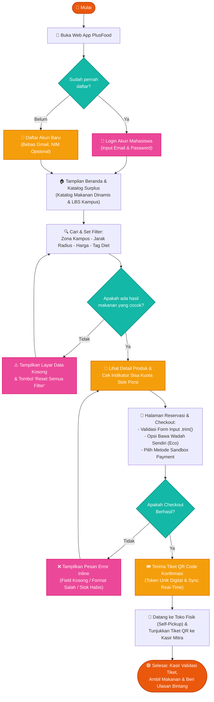
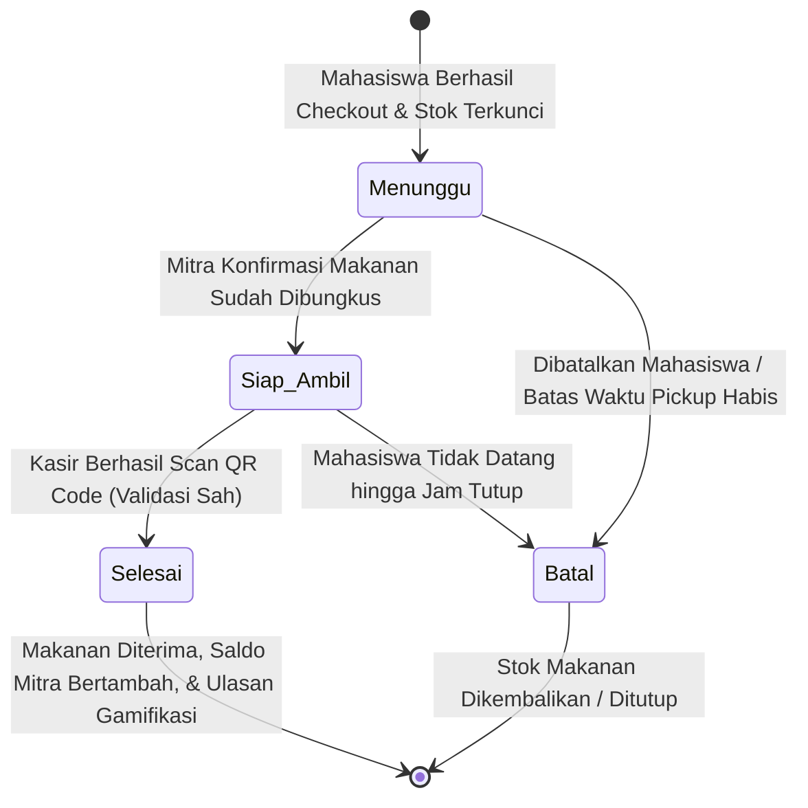
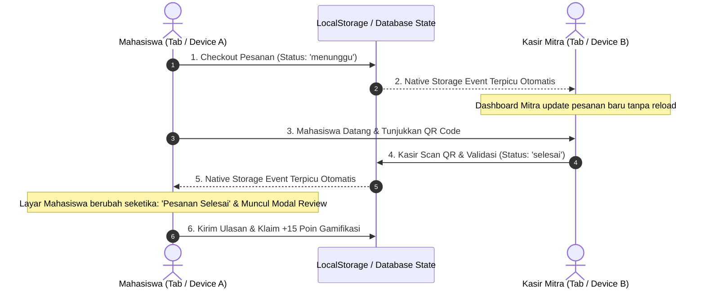

# 🔄 04. Alur Kerja Pengguna (User Flow) & Panduan Sistem - PlusFood

> **Dokumen Teknis Alur Kerja Sistem (System User Flow & Operating Guide)**  
> *Platform Penyelamatan Makanan Surplus Kampus Berbasis Dual-Perspective (Mahasiswa & Mitra UMKM).*

---

## 📌 1. Pendahuluan & Filosofi Alur Kerja

Platform **PlusFood** dirancang dengan prinsip **Dual-Perspective Interconnected Flow** (sudut pandang ganda yang saling terhubung secara real-time) antara **Mahasiswa (Konsumen)** dan **Mitra UMKM (Penyedia Makanan di Kantin Kampus)**:

1. **Mahasiswa (Fast Rescue & Privacy-Friendly):**
   - **Zero Friction Onboarding:** Pendaftaran bebas menggunakan email pribadi (Gmail/Yahoo) maupun email kampus, serta **tidak diwajibkan mengisi NIM** (`nim` nullable) guna melindungi privasi mahasiswa.
   - **Location-Based Campus Zone:** Filter radius presisi di sekitar kampus (500 meter s/d 5 km) dari kantin mitra.
   - **Single-Item Instant Rescue:** Mengurangi kerumitan keranjang belanja, mempercepat checkout makanan surplus malam sebelum kedai tutup, dan mencegah *race-condition* perebutan stok.
   - **Sandbox Payment Simulator:** Simulasi pembayaran instan (QRIS, GoPay, DANA, dan Bayar di Kasir) tanpa perlu akun vendor gateway berbayar atau kartu kredit.
2. **Mitra UMKM (Capital Recovery & Zero Hassle):**
   - **Tambah Surplus Kilat (< 1 Menit):** Mitra hanya perlu memasukkan nama makanan, porsi sisa malam, harga asli, diskon otomatis, dan jam pickup.
   - **Zero-Vendor Real-Time Monitoring:** Notifikasi pesanan masuk tersinkronisasi seketika antar-tab browser menggunakan *Native HTML5 Storage Event* tanpa ketergantungan server WebSocket pihak ketiga (Pusher/Ably).
   - **Validasi Kasir Anti-Klaim Ganda (*Double-Claim Protection*):** Pemindaian kode QR digital atau input manual 3-digit token di kasir dengan pencatatan audit log otomatis (`qr_scan_logs`).
   - **Pemberdayaan Finansial:** Saldo dompet omzet langsung bertambah secara atomik (`balance_rp`) dan dapat dicairkan kapan saja ke rekening bank (*payout request*).

---

## 🧑‍🎓 2. Alur Pengguna: POV Mahasiswa (Penyelamat Makanan)

### A. Diagram Alur Visual (Flowchart Mahasiswa)

Alur berikut memetakan perjalanan lengkap mahasiswa mulai dari mengakses web app, registrasi, eksplorasi katalog surplus, validasi filter, reservasi checkout, hingga pengambilan makanan di kasir:

---

### B. Uraian Langkah Detail Alur Mahasiswa

#### 1. Onboarding & Otentikasi Ramah Privasi
* **Buka Aplikasi:** Mahasiswa membuka platform PlusFood via browser perangkat ponsel atau desktop.
* **Cek Akun:**
  - **Login:** Jika sudah terdaftar, login menggunakan alamat email dan kata sandi.
  - **Daftar Akun Baru:** Mengisi formulir pendaftaran. Sistem menerapkan **kebijakan ramah privasi**:
    - Email bersifat bebas (dapat menggunakan personal Gmail/Yahoo maupun email kampus resmi).
    - Kolom **NIM bersifat opsional (nullable)**, menjamin mahasiswa tidak terhambat birokrasi verifikasi KTM saat butuh makanan murah di malam hari.

#### 2. Eksplorasi Katalog & Filtering Interaktif (Modul 8 Vinix)
* **Katalog Berbasis Data Dinamis:** Seluruh item makanan dimuat secara dinamis dari database tanpa data *hardcoded* (`v-for` interaktif).
* **Multi-Filter Terintegrasi:**
  - **Pilar LBS (Lokasi Kampus):** Memilih zona kampus (UNESA Ketintang, UNESA Lidah Wetan, UNAIR Kampus B, ITS Sukolilo).
  - **Radius Jarak:** Pilihan radius jarak jalan kaki/motor (500 meter, 1 km, 2 km, 3 km, 5 km).
  - **Rentang Harga Surplus:** Filter makanan hemat di bawah Rp10.000 atau Rp15.000.
  - **Tag Preferensi Diet:** Checkbox chip pantangan makanan (`Halal`, `Vegetarian`, `Bebas Kacang`, `Tidak Pedas`).
* **Kondisi Tanpa Hasil (*Empty State Handling*):**
  - Jika kombinasi filter tidak menemukan makanan yang cocok, sistem menampilkan ilustrasi layar kosong informatif dengan pesan: *"Tidak ada makanan yang cocok dengan filter Anda"*.
  - Disediakan tombol **"Reset Semua Filter"** yang langsung mengembalikan tampilan katalog ke seluruh menu aktif tanpa reload halaman.

#### 3. Detail Produk & Indikator Sisa Kuota Stok
* Mahasiswa memilih salah satu makanan surplus.
* Halaman Detail Produk menyajikan:
  - **Badge Status Stok Real-Time:** Menampilkan sisa porsi yang tersedia (misal: *"Sisa 2 Porsi"* berwarna oranye peringatan).
  - **Jam Ambil Malam (*Pickup Window*):** Jam resmi pengambilan sebelum gerai tutup (contoh: *19.30 – 20.30 WIB*).
  - **Jaminan Kualitas:** Informasi kebersihan makanan (*Dimasak Hari Ini*, *Kemasan Higienis Tertutup*).
  - **Kalkulator Penghematan:** Menampilkan perbandingan harga asli warung vs harga diskon penyelamatan (diskon hingga 50%–70%).

#### 4. Formulir Reservasi & Validasi Checkout
* Mahasiswa menekan tombol **"Pesan Sekarang"** menuju halaman Checkout.
* **Validasi & Sanitasi Data Input (Kriteria Rubrik Modul 8):**
  - Seluruh field form (`Nama`, `No. WhatsApp`, `Alamat Kost`, `Email`) disanitasi otomatis menggunakan fungsi pembersih spasi `.trim()`.
  - **Validasi Inline Real-Time:** Pesan error berwarna merah muncul langsung di bawah field input jika input tidak valid (misal: nomor WhatsApp kurang dari 10 digit, format email salah tanpa simbol `@`, atau field wajib dibiarkan kosong).
* **Pilihan Kemasan Ramah Lingkungan (*Eco-Packaging*):**
  - *Bawa Wadah Sendiri (Gratis / Rp0)* — Mendukung pengurangan sampah plastik sekali pakai.
  - *Kotak Kertas Kraft (+Rp1.000)*
  - *Kotak Thinwall Reusable (+Rp2.000)*
* **Metode Pembayaran Sandbox Simulator (100% Non-Tunai / Zero-Cash Policy):**
  - Mahasiswa memilih kanal pembayaran digital: **QRIS Dinamis**, **GoPay Sandbox**, atau **DANA Sandbox**.
  - **Proteksi Mitra Anti-Ghosting:** Opsi bayar tunai di tempat sengaja ditiadakan (*100% Cashless*) untuk melindungi mitra UMKM dari risiko order fiktif / pembatalan sepihak saat jam tutup toko hampir berakhir.
  - Menggunakan simulasi lokal *zero-vendor* berlabel referensi otomatis `SBX-QRIS-PF84920`.

#### 5. Penerbitan Tiket QR Digital & Penjemputan (*Self-Pickup*)
* Setelah checkout berhasil:
  - Sistem mengunci kuota stok makanan (*stock decrement*).
  - Menerbitkan **Tiket Digital Unik** berisikan kode alfanumerik (contoh: `PF-84920-WS`) dan QR Code grafis.
  - Pesanan masuk ke tab **"Menunggu Pickup"** di halaman Riwayat Pesanan lengkap dengan timer hitung mundur.
* **Pengambilan Makanan di Gerai:**
  - Mahasiswa mendatangi stand kantin mitra sebelum batas jam operasional berakhir.
  - Mahasiswa menunjukkan layar tiket QR di ponsel kepada kasir mitra.

#### 6. Penyelesaian & Evaluasi Dampak Lingkungan
* Setelah kasir memindai tiket, pesanan berpindah status ke **"Selesai"**.
* **Dampak Gamifikasi Hijau Akumulatif:**
  - Metrik akun mahasiswa bertambah: estimasi gram emisi CO2 yang dicegah (`co2_saved_grams`) dan total uang saku yang dihemat (`money_saved_rp`).
  - Mahasiswa mendapatkan kesempatan memberi ulasan bintang 1–5, komentar, dan tag evaluasi kepuasan untuk mengklaim **+15 Poin Penghargaan Hijau (*Green Rescuer Points*)**.

---

## 🏪 3. Alur Pengguna: POV Mitra UMKM (Kantin / Gerai Makanan)

### A. Diagram Alur Visual (Flowchart Mitra UMKM)

```mermaid
flowchart TD
    M_Start(["🔴 Mulai"]) --> M_Open["🏪 Akses Portal Khusus Mitra UMKM"]
    M_Open --> M_Auth{"Sudah memiliki\nakun mitra?"}

    M_Auth -- Ya --> M_Login["🔑 Login Akun Mitra"]
    M_Auth -- Belum --> M_Register["📝 Pendaftaran Gerai Mitra:\nInput Nama Warung, NIB UMKM, Stand Kantin, & Rekening Bank"]

    M_Login --> M_Dashboard["📊 Masuk ke Mitra Dashboard:\n- Ringkasan Omzet Terselamatkan\n- Sisa Porsi Aktif Malam Ini\n- Grafik Analitik Pemulihan (Recovery Rate)"]
    M_Register --> M_Dashboard

    M_Dashboard --> M_AddSurplus["⚡ Fitur Tambah Surplus Kilat (< 1 Menit):\n- Nama Menu Masakan & Foto\n- Harga Normal & Harga Diskon (Kalkulasi Otomatis)\n- Sisa Kuota Porsi Malam & Jam Pengambilan\n- Tag Alergen & Dukungan Bawa Wadah"]
    M_AddSurplus --> M_Publish["🚀 Klik 'Terbitkan Menu Surplus'"]

    M_Publish --> M_Monitor["👀 Monitoring Pesanan Masuk (Real-Time)\n(Sinkronisasi Instan Lintas-Tab Browser via Storage Event)"]
    M_Monitor --> M_StudentArrives["🚶 Mahasiswa Datang ke Stand Menunjukkan Tiket QR"]

    M_StudentArrives --> M_Scan["📷 Buka Scanner Kasir:\nArahkan Kamera ke QR Code atau Ketik Manual 3-Digit Token"]
    M_Scan --> M_Validate{"Validasi Tiket Sistem\n(Pengecekan Database & Audit Log)"}

    M_Validate -- Kode Salah / Kadaluarsa --> M_Error["❌ Peringatan: Kode Tiket Tidak Ditemukan\natau Jam Pengambilan Telah Hangus"]
    M_Validate -- Sudah Pernah Diambil --> M_DoubleClaim["⚠️ Peringatan Merah: Tiket Sudah Pernah Diambil!\n(Proteksi Anti-Klaim Ganda)"]
    M_Error --> M_Scan
    M_DoubleClaim --> M_Scan

    M_Validate -- Tiket Sah & Valid --> M_Success["✅ Tiket Terverifikasi Sah:\n- Status Pesanan Berubah Menjadi 'Selesai'\n- Saldo Dompet Mitra Otomatis Bertambah (balance_rp)\n- Metrik Omzet Harian Terakumulasi (merchant_daily_metrics)"]

    M_Success --> M_Handover["🍱 Serahkan Makanan Surplus ke Mahasiswa"]
    M_Handover --> M_PayoutCheck{"Ingin Mencairkan\nSaldo Dompet?"}

    M_PayoutCheck -- Ya --> M_PayoutRequest["💸 Ajukan Pencairan Dana (Payout Request):\nInput Nominal -> Terbit Tiket Payout -> Transfer ke Rekening Bank"]
    M_PayoutCheck -- Tidak --> M_Finish(["🟢 Selesai: Tutup Stand Kantin dengan Modal Terselamatkan"])
    M_PayoutRequest --> M_Finish

    style M_Start fill:#ea580c,stroke:#c2410c,stroke-width:2px,color:#fff
    style M_Finish fill:#ea580c,stroke:#c2410c,stroke-width:2px,color:#fff
    style M_Auth fill:#14b8a6,stroke:#0d9488,stroke-width:2px,color:#fff
    style M_Validate fill:#14b8a6,stroke:#0d9488,stroke-width:2px,color:#fff
    style M_PayoutCheck fill:#14b8a6,stroke:#0d9488,stroke-width:2px,color:#fff
    style M_Login fill:#ec4899,stroke:#db2777,stroke-width:2px,color:#fff
    style M_Register fill:#f59e0b,stroke:#d97706,stroke-width:2px,color:#fff
    style M_Error fill:#ec4899,stroke:#db2777,stroke-width:2px,color:#fff
    style M_DoubleClaim fill:#ec4899,stroke:#db2777,stroke-width:2px,color:#fff
    style M_AddSurplus fill:#f59e0b,stroke:#d97706,stroke-width:2px,color:#fff
    style M_Success fill:#10b981,stroke:#059669,stroke-width:2px,color:#fff
    style M_PayoutRequest fill:#f59e0b,stroke:#d97706,stroke-width:2px,color:#fff
```

---

### B. Uraian Langkah Detail Alur Mitra UMKM

#### 1. Registrasi Profil & Legalitas Usaha
* Mitra UMKM mendaftarkan gerai melalui portal `/mitra/register`.
* Data yang direkam mencakup nama gerai, nama pemilik, legalitas NIB (Nomor Induk Berusaha), lokasi fisik stand di kantin kampus, serta nomor rekening perbankan untuk penampungan pencairan dana.

#### 2. Unggah Makanan Surplus Kilat (*Quick Posting < 1 Menit*)
* Menjelang jam tutup kantin (misal pukul 17.00 – 19.00 WIB), pemilik warung membuka form *Tambah Surplus Kilat*.
* Pemilik warung memasukkan:
  - Nama masakan (contoh: *Paket Ayam Geprek Sambal Korek*).
  - Jumlah porsi surplus yang masih layak konsumsi (contoh: 4 porsi).
  - Harga normal (misal Rp18.000) dan harga penyelamatan (misal Rp8.000). Sistem secara otomatis menghitung persentase diskon hemat (55%).
  - Jam pengambilan malam (misal *19.30 – 20.30 WIB*).
  - Tag kebersihan dan pantangan alergen.
* Setelah menekan tombol terbitkan, menu langsung aktif di katalog mahasiswa.

#### 3. Monitoring Pesanan Masuk (Sinkronisasi Real-Time Dua Arah)
* Setiap kali ada mahasiswa yang menyelesaikan checkout di tab/perangkat lain, Dashboard Mitra langsung memperbarui daftar pesanan secara otomatis tanpa reload halaman.
* Mekanisme ini memanfaatkan **Native Cross-Tab Storage Event Synchronization** yang bebas biaya dan 100% tahan terhadap pembatasan jaringan WiFi kampus.

#### 4. Pemindaian & Verifikasi Kasir (Proteksi Anti-Klaim Ganda)
* Saat mahasiswa tiba di stand:
  - Kasir menekan tombol pemindai di Dashboard Kasir.
  - Kasir mengarahkan kamera ke QR Code mahasiswa (atau mengetikkan 3-digit kode cepat jika kamera bermasalah).
* **Validasi Keamanan Otomatis:**
  - Sistem memeriksa keabsahan token pada tabel `orders`.
  - Jika tiket berstatus `selesai`, sistem menolak dan membunyikan alarm **"Tiket Sudah Pernah Diambil!"** untuk mencegah kecurangan klaim ganda.
  - Setiap upaya scan dicatat ke dalam audit log `qr_scan_logs` (waktu scan, ID kasir, alamat IP, dan hasil).
  - Jika tiket valid, status pesanan berubah menjadi `selesai` dan pembayaran dinyatakan lunas.

#### 5. Akumulasi Omzet & Penarikan Saldo (*Payout*)
* Saldo dompet penjualan mitra (`balance_rp`) bertambah secara atomik sesuai nilai pesanan.
* Halaman Analitik secara otomatis mengkalkulasi persentase makanan yang terselamatkan (*Recovery Rate* %) dan total gram emisi yang berhasil dicegah.
* Mitra dapat mengajukan pencairan saldo dompet ke rekening bank terdaftar melalui menu *Penarikan Dana (Payout)*, yang mencatat nomor tiket penarikan (`merchant_payouts`).

---

## ⚙️ 4. Siklus Hidup Pesanan (*Order Lifecycle & State Machine*)

Status pesanan pada sistem PlusFood dikontrol melalui state machine yang ketat guna menjamin integritas transaksi:

| State / Status | Deskripsi Teknis | Aksi Mahasiswa | Aksi Mitra UMKM |
|---|---|---|---|
| **`menunggu`** | Pesanan berhasil dibuat, stok makanan terpotong, token QR digital diterbitkan. | Memantau jam pickup & bersiap menuju kantin. | Menyiapkan makanan yang dipesan. |
| **`siap_ambil`** | Makanan telah dikemas dan siap di etalase kasir. | Segera menuju stand dan menunjukkan QR. | Menunggu kedatangan mahasiswa. |
| **`selesai`** | Tiket QR berhasil discan kasir secara sah. | Mengambil makanan & memberikan rating review. | Saldo dompet bertambah, porsi tercatat selamat. |
| **`batal`** | Dibatalkan oleh pengguna atau kedaluwarsa melewati jam operasional. | Tiket hangus, pesanan masuk tab Dibatalkan. | Porsi dikembalikan ke stok jika masih layak. |

---

## 🔒 5. Matriks Validasi Form & Penanganan Error (Modul 8 Vinix)

Berdasarkan rubrik penilaian kompetensi data dinamis dan form sanitasi:

| Halaman / Form | Field Input | Aturan Validasi | Respon Sistem Saat Invalid |
|---|---|---|---|
| **Checkout Mahasiswa** | `Nama Lengkap` | Wajib diisi, `.trim()`, minimal 3 karakter. | Teks merah: *"Nama lengkap wajib diisi minimal 3 karakter."* |
| **Checkout Mahasiswa** | `No. WhatsApp` | Wajib diisi, angka numerik, 10–15 digit. | Teks merah: *"Nomor WhatsApp tidak valid (10-15 digit numerik)."* |
| **Checkout Mahasiswa** | `Email` | Wajib diisi, format email valid (`@` & `.`). | Teks merah: *"Format email tidak valid (contoh: nama@gmail.com)."* |
| **Checkout Mahasiswa** | `Alamat Kost` | Wajib diisi, `.trim()`. | Teks merah: *"Alamat kos/penjemputan wajib diisi."* |
| **Checkout Mahasiswa** | `NIM` | **Opsional (Nullable)**. | Tetap valid jika kosong (ramah privasi). |
| **Katalog Makanan** | `Filter Pencarian`| Jika hasil query `0` porsi. | Menampilkan ilustrasi *Empty State* + tombol *"Reset Filter"*. |
| **Tambah Menu Mitra** | `Harga Diskon` | Wajib lebih rendah dari harga normal. | Teks merah: *"Harga diskon surplus harus lebih murah dari harga normal."* |
| **Tambah Menu Mitra** | `Sisa Porsi` | Minimal 1 porsi, bilangan bulat. | Teks merah: *"Jumlah porsi surplus minimal 1 porsi."* |
| **Scanner Kasir** | `QR Token` | Token harus ada di tabel `orders` & belum `selesai`. | Layar modal merah: *"Tiket Salah / Sudah Pernah Diambil!"* |
| **Pencairan Saldo** | `Nominal Payout`| Nominal $\le$ `merchants.balance_rp`. | Pesan peringatan: *"Saldo dompet tidak mencukupi untuk penarikan."* |

---

## 🌐 6. Arsitektur Komunikasi Real-Time Tanpa Vendor (*Zero-Vendor Principle*)

Sistem sinkronisasi status pesanan antara antarmuka Mahasiswa dan Mitra UMKM diimplementasikan secara elegan tanpa dependensi vendor pihak ketiga:

* **Keunggulan:**
  1. **Bebas Biaya Operasional:** Tidak membutuhkan kuota berbayar pesan WebSocket (Pusher/Ably).
  2. **Bypass Firewall Kampus:** Banyak jaringan WiFi kampus memblokir port WebSocket khusus (port 6001, 8080, dsb), namun komunikasi berbasis storage event bawaan browser ini 100% kebal terhadap blokir proxy kampus.
  3. **Zero Configuration:** Berjalan langsung di semua browser modern tanpa instalasi modul tambahan.

---

Dokumen ini disusun sebagai panduan operasional interaksi sistem dan pelengkap pengujian teknis platform PlusFood © 2026.
