# 🗄️ Dokumentasi Skema Database & Relasi Entitas - PlusFood

> **Dokumen Teknis Spesifikasi Database (Database Schema & Entity Relationship)**  
> *Platform Penyelamatan Makanan Surplus Kampus Berbasis Dual-Perspective (Mahasiswa & Mitra UMKM).*

---

## 📌 1. Filosofi & Pendekatan Desain Database

Arsitektur database PlusFood dirancang berdasarkan prinsip-prinsip utama dual-perspective:

1. **Inklusif & Ramah Privasi Mahasiswa (*Privacy-First & Zero Friction*):**
   - Mahasiswa **tidak diwajibkan memiliki atau memasukkan NIM** (kolom `nim` bersifat `nullable`).
   - Mahasiswa **bebas menggunakan email pribadi (Gmail/Yahoo/dsb) maupun email institusi kampus**, memudahkan adopsi cepat tanpa hambatan birokrasi verifikasi akun kampus.
2. **Pemberdayaan Finansial Mitra UMKM (*Capital Recovery & Fast Posting*):**
   - Mendukung pencatatan modal terselamatkan (*capital recovery*), saldo dompet penjualan (`balance_rp`), serta permohonan pencairan dana (`merchant_payouts`) ke rekening bank mitra.
   - Fitur *Tambah Surplus Kilat (< 1 menit)* menyimpan kuota stok dan kalkulasi diskon otomatis.
3. **Audit Validasi Kasir & Proteksi Anti Klaim Ganda (*Double-Claim Protection*):**
   - Setiap pemindaian QR code kasir terekam dalam `qr_scan_logs` (waktu scan, petugas kasir, metode kamera/manual, dan hasil verifikasi).
4. **Paradigma Single-Item Fast Rescue (*Zero Race-Condition*):**
   - Makanan surplus yang dijual di malam hari memiliki stok terbatas (1–5 porsi).
   - Tabel `orders` berfokus pada reservasi instan per item untuk mencegah konflik konkurensi antar mahasiswa berebut porsi.
5. **Pilar LBS (*Location-Based Campus Zones*):**
   - Setiap mitra (`merchants`) dan makanan (`foods`) dipetakan ke dalam zona kampus (`campus_zone`), memungkinkan filter radius instan (500m – 3km).
6. **Gamifikasi Penyelamatan Makanan (*Green Impact Tracker*):**
   - Tabel `users` secara kumulatif mencatat metrik dampak: gram emisi CO2 dicegah (`co2_saved_grams`), total penghematan rupiah (`money_saved_rp`), dan level penghargaan (*Green Rescuer Level*).
7. **Sandbox Payment Simulator & Zero-Vendor Real-Time Architecture:**
   - **Metode Pembayaran:** Menggunakan **Sandbox Payment Simulator** (Mock QRIS Dinamis, E-Wallet Sandbox GoPay/DANA, dan Tunai Kasir) dengan pencatatan `payment_gateway` (`'sandbox_simulator'`) dan `payment_reference` (`'SBX-QRIS-PF84920'`). Tidak membutuhkan akun vendor produksi berbayar atau kredensial rahasia yang rawan kedaluwarsa.
   - **Tanpa WebSocket Vendor Pihak Ketiga (No Pusher / No Ably / No Socket.io Server):** Sinkronisasi status pesanan dan tiket QR antara tab Mahasiswa dan Mitra memanfaatkan **Browser Cross-Tab Storage Event Synchronization** (`window.addEventListener('storage', ...)`). Ini menjamin keterhubungan real-time instan dengan **zero configuration**, bebas biaya, dan 100% tahan banting terhadap firewall/proxy WiFi kampus yang sering memblokir port WebSocket.

---

## 🏛️ 2. Analisis Normalisasi Basis Data (Pragmatic 3NF & Strategic Denormalization)

Skema database PlusFood mengadopsi arsitektur **Relasional Hibrida Ter-normalisasi (Pragmatic Third Normal Form / 3NF)** yang dipadukan secara terukur dengan **Strategic Denormalization**. Pendekatan ini merupakan standar de-facto industri perangkat lunak modern untuk sistem *Food-Tech* dan *E-Commerce* (seperti Gojek, Grab, ShopeeFood) guna menyeimbangkan antara **integritas relasional tanpa redundansi** dan **kecepatan baca/tulis transaksi tinggi (*low latency*)**.

### A. Evaluasi Kepatuhan Kaidah Normalisasi Formal

#### 1. Bentuk Normal Pertama (1NF - First Normal Form)
* **Kriteria:** Setiap tabel memiliki baris yang teridentifikasi secara unik, setiap sel bernilai atomik (satu nilai logis), dan tidak ada grup kolom yang berulang (*repeating groups*).
* **Implementasi di PlusFood:**
  - Setiap tabel menggunakan Primary Key bertipe numerik auto-increment (`id BIGINT UNSIGNED`).
  - Atribut entitas seperti nama, email, nomor telepon, dan status disimpan dalam kolom tersendiri secara atomik.
  - *Pemanfaatan Kolom JSON Modern:* Atribut `dietary_tags` pada tabel `foods` dan `tags` pada tabel `reviews` disimpan menggunakan tipe data `JSON` bawaan database. Dalam rekayasa perangkat lunak modern (PostgreSQL/MySQL 8/SQLite 3.38+), pendekatan *semi-structured JSON attribute* untuk tag chip/badge non-relasional diakui secara luas karena menghindari keharusan membuat 4 tabel *junction* perantara (*over-engineering*) yang membebani query `JOIN` hanya untuk membaca label visual seperti `["Halal", "Tidak Pedas"]`.

#### 2. Bentuk Normal Kedua (2NF - Second Normal Form)
* **Kriteria:** Telah memenuhi 1NF, dan setiap atribut non-kunci harus bergantung penuh secara fungsional (*fully functional dependent*) pada Primary Key tabel (tidak boleh ada ketergantungan parsial / *partial dependency*).
* **Implementasi di PlusFood:**
  - Karena seluruh tabel PlusFood mengadopsi pola *Surrogate Primary Key* tunggal (`id`), maka secara matematis **ketergantungan parsial tidak mungkin terjadi** (ketergantungan parsial hanya dapat muncul jika Primary Key berbentuk kunci komposit/*composite key*).
  - Setiap kolom non-kunci (seperti `price_discount`, `stock`, `pickup_time_start`) bergantung secara mutlak pada ID baris tersebut.

#### 3. Bentuk Normal Ketiga (3NF - Third Normal Form)
* **Kriteria:** Telah memenuhi 2NF, dan tidak ada ketergantungan transitif (*no transitive dependency*) di mana atribut non-kunci bergantung pada atribut non-kunci lainnya ($X \to Y \to Z$).
* **Implementasi di PlusFood:**
  - Seluruh domain master data telah dipisahkan ke dalam tabel entitas mandiri yang dihubungkan melalui *Foreign Key*:
    - Informasi gerai mitra UMKM (`name`, `nib`, `canteen_location`, `bank_account`) dipisahkan ke tabel `merchants`, bukan menumpang di dalam tabel `foods`.
    - Preferensi filter diet mahasiswa dipisahkan ke tabel `user_preferences`, bukan menumpuk di tabel `users`.
    - Data ulasan dan rating dipisahkan ke tabel `reviews`, bukan disatukan di tabel `orders`.
    - Pengajuan pencairan saldo omzet dipisahkan ke tabel `merchant_payouts`.
    - Riwayat keamanan scanner kasir dipisahkan ke tabel `qr_scan_logs`.

---

### B. Strategic Denormalization (Pola Standar Industri E-Commerce)

Meskipun fondasi skema mengikuti kaidah 3NF, terdapat area kunci di mana diterapkan **denormalisasi terkontrol yang disengaja (*intentional strategic denormalization*)**:

```mermaid
flowchart TD
    subgraph S1["1. Snapshot Transaksi Finansial (orders)"]
        A["Food: price = 10.000"] -->|Saat Checkout| B["Order: subtotal = 10.000 (Snapshot)"]
        C["User: name = Raka"] -->|Saat Checkout| D["Order: customer_name = Raka (Snapshot)"]
        E["Food diubah: price = 15.000"] -.->|TIDAK mengubah nota lama| B
    end

    subgraph S2["2. Counter-Cache Performa Tinggi (merchants & users)"]
        F["Tiap Order Berhasil Selesai"] -->|Atomic Increment| G["merchants.balance_rp += subtotal"]
        F -->|Atomic Increment| H["users.co2_saved_grams += 400g"]
        I["Dashboard Request"] -->|O(1) Direct Read| J["Fast Load tanpa SUM() Ribuan Baris"]
    end
```

#### 1. Snapshot Riwayat Transaksi (*Immutable Historical Receipt Pattern*) pada `orders`:
* **Kolom Terdampak:** `customer_name`, `customer_phone`, `customer_email`, `customer_address`, `customer_nim`, `subtotal`, `total_price`, `money_saved`.
* **Rationale Teknis & Bisnis:**
  Dalam sistem keuangan, e-commerce, dan faktur pajak, **nota/struk transaksi yang sudah diterbitkan wajib bersifat kekal (*immutable*)**. Jika seorang mitra memperbarui harga menu di tabel `foods` pada minggu depan, atau mahasiswa memperbarui nomor telepon/pindah alamat di tabel `users`, data struk pesanan yang terjadi hari ini **tidak boleh ikut berubah secara retroaktif**. Menyimpan snapshot ini melindungi integritas audit finansial dan mencegah sengketa pesanan.

#### 2. Counter-Cache Akumulasi Saldo & Metrik Gamifikasi (*Zero-Latency Read Aggregation*):
* **Kolom Terdampak:** `merchants.balance_rp`, `merchants.total_revenue_rp`, `users.co2_saved_grams`, `users.money_saved_rp`, `users.portions_rescued`.
* **Rationale Teknis & Bisnis:**
  Setiap kali mahasiswa membuka halaman Beranda atau mitra membuka Dashboard, sistem harus menampilkan total saldo dompet dan total gram CO2 yang dicegah. Jika kolom ini dihitung murni secara 3NF (menggunakan fungsi agregat `SUM()` dan `COUNT()` terhadap seluruh riwayat transaksi di tabel `orders`), maka kompleksitas query adalah $O(N)$ yang akan melumpuhkan performa basis data saat volume transaksi bertumbuh. Dengan menyimpan akumulator ter-cache yang diperbarui secara atomik (`DB::transaction()`) saat status pesanan menjadi `selesai`, proses pembacaan menjadi $O(1)$ instan (*sub-millisecond*).

#### 3. Daily Analytics Pre-aggregation (`merchant_daily_metrics`):
* Meringkas penjualan per hari (`metric_date`) untuk visualisasi grafik analitik cepat pada dashboard mitra tanpa membebani tabel transaksional `orders`.

---

## 👤 3. Matriks Pemetaan Antarmuka (UI/UX) ke Skema Database

Seluruh elemen formulir dan tampilan data pada antarmuka pengguna PlusFood memiliki representasi data yang sinkron dan terpetakan secara presisi:

### A. Antarmuka Mahasiswa (`resources/js/Pages/Mahasiswa/Profil.vue`)

| Komponen / Field UI | Tipe Input | Kolom Database Tujuan | Keterangan & Karakteristik |
|---|---|---|---|
| **Nama Lengkap** | Text Input | `users.name` | Nama mahasiswa terdaftar. |
| **Email Akun** | Email Input | `users.email` | Mendukung **email pribadi (Gmail/dsb) maupun email institusi**. |
| **Nomor WhatsApp** | Tel Input | `users.phone` | Kontak untuk konfirmasi penjemputan makanan. |
| **Kampus Binaan** | Select Dropdown | `users.campus` | Kampus tempat beraktivitas (contoh: "UNESA Ketintang"). |
| **Program Studi / Jurusan** | Text Input | `users.major` | Jurusan mahasiswa (contoh: "S1 Teknik Informatika · 2023"). |
| **NIM (Nomor Induk)** | Text Input | `users.nim` | **Bersifat Nullable (Opsional).** Menjaga privasi tanpa hambatan birokrasi. |
| **Alamat Domisili / Kost** | Text Input | `users.address` | Alamat tempat tinggal untuk acuan jarak penjemputan. |
| **Foto Profil / Avatar** | Image URL | `users.avatar` | Foto avatar pengguna. |
| **Zona Kampus Default** | Select Dropdown | `user_preferences.campus_zone` | Zona filter katalog (contoh: `unesa-ketintang`). |
| **Radius Penjemputan** | Pill Radio | `user_preferences.radius` | Radius jarak pencarian makanan (500m – 5km). |
| **Preferensi Halal** | Checkbox Chip | `user_preferences.prefer_halal` | Filter otomatis makanan bersertifikat halal. |
| **Preferensi Vegetarian** | Checkbox Chip | `user_preferences.prefer_vegetarian`| Filter khusus menu tanpa olahan daging. |
| **Bebas Alergen Kacang** | Checkbox Chip | `user_preferences.prefer_nut_free` | Filter keamanan alergi kacang-kacangan. |
| **Preferensi Tidak Pedas** | Checkbox Chip | `user_preferences.prefer_not_spicy` | Filter menu ramah lambung / non-pedas. |
| **Portofolio Jejak Hijau** | Visual Cards | `users.co2_saved_grams`<br>`users.money_saved_rp`<br>`users.portions_rescued` | Metrik kumulatif penyelamatan surplus makanan. |
| **Pangkat Penyelamat** | Badge Level | `users.rescuer_level` | Level gamifikasi (Level 1–5: Rescuer Pemula s/d Guardian). |

---

### B. Antarmuka Mitra UMKM (`resources/js/Pages/Mitra/Profil.vue`)

| Komponen / Field UI | Tipe Input | Kolom Database Tujuan | Keterangan & Karakteristik |
|---|---|---|---|
| **Nama Gerai / Warung** | Text Input | `merchants.name` | Nama usaha/warung makan di kantin. |
| **Nama Pemilik Usaha** | Text Input | `merchants.owner_name` | Penanggung jawab operasional gerai mitra. |
| **Nomor Telepon Gerai** | Tel Input | `merchants.phone` | Nomor kontak gerai untuk komunikasi pelanggan. |
| **Email Pengelola** | Email Input | `users.email` (via `user_id`) | Email akun otentikasi login pemilik mitra. |
| **NIB (Nomor Induk Berusaha)** | Text Input | `merchants.nib` | Legalitas resmi UMKM (contoh: `NIB 9120004510291`). |
| **Zona Kampus** | Select Dropdown | `merchants.campus_zone` | Area operasional gerai (contoh: `unesa-ketintang`). |
| **Lokasi Kantin & Stand** | Text Input | `merchants.canteen_location` | Lokasi fisik stand (contoh: "Kantin Vokasi Lt. 1 Stand 04"). |
| **Sesi Waktu Standar** | Select Dropdown | `merchants.default_session` | Sesi surplus dominan: `siang`, `sore`, atau `malam`. |
| **Jam Operasional Ambil** | Text Input | `merchants.operating_hours` | Rentang waktu penjemputan (contoh: "19.00 – 20.30 WIB"). |
| **Dukung Bawa Wadah Sendiri** | Toggle Switch | `merchants.support_eco` | Memberikan opsi tanpa biaya kemasan plastik (`eco_packaging`). |
| **Nama Bank Penerima** | Select / Text | `merchants.bank_name` | Bank tujuan transfer pencairan (BCA, Mandiri, BRI, BNI). |
| **Nomor Rekening Bank** | Text Input | `merchants.bank_account` | Nomor rekening penampungan pencairan dana. |
| **Nama Pemilik Rekening** | Text Input | `merchants.bank_holder` | Nama pada buku tabungan rekening pencairan dana. |
| **Saldo Dompet Aktif** | Display Card | `merchants.balance_rp` | Saldo hasil penjualan surplus yang siap dicairkan (*payout*). |
| **Akumulasi Omzet Selamat** | Display Card | `merchants.total_revenue_rp` | Total nilai rupiah modal surplus yang terselamatkan. |

---

## 📊 4. Entity Relationship Diagram (ERD) Dual-Perspective

```mermaid
erDiagram
    USERS ||--o{ ORDERS : "places"
    USERS ||--o{ REVIEWS : "writes"
    USERS ||--o| USER_PREFERENCES : "configures"
    USERS ||--o| MERCHANTS : "owns (mitra)"
    USERS ||--o{ QR_SCAN_LOGS : "scans (cashier)"

    MERCHANTS ||--o{ FOODS : "supplies"
    MERCHANTS ||--o{ ORDERS : "fulfills"
    MERCHANTS ||--o{ MERCHANT_PAYOUTS : "withdraws"
    MERCHANTS ||--o{ QR_SCAN_LOGS : "logs_verifications"
    MERCHANTS ||--o{ MERCHANT_DAILY_METRICS : "tracks_analytics"

    FOODS ||--o{ ORDER_ITEMS : "included_in"
    FOODS ||--o{ REVIEWS : "reviewed_in"

    ORDERS ||--o{ ORDER_ITEMS : "contains"
    ORDERS ||--|| PAYMENTS : "paid_through"
    ORDERS ||--o| REVIEWS : "evaluated_by"
    ORDERS ||--o{ QR_SCAN_LOGS : "validated_in"

    USERS {
        bigint id PK
        string name
        string email
        string password
        enum role "mahasiswa, mitra, admin"
        string phone
        string campus
        string major "nullable"
        string nim "nullable"
        string address "nullable"
        string avatar
        int co2_saved_grams
        bigint money_saved_rp
        int portions_rescued
        tinyint rescuer_level
        timestamps timestamps
    }

    MERCHANTS {
        bigint id PK
        bigint user_id FK
        string name
        string owner_name
        string slug UK
        string nib "nullable"
        string campus_zone
        string campus_name
        string category
        string address
        string canteen_location
        string phone
        decimal rating
        int reviews_count
        boolean is_verified
        string operating_hours
        enum default_session "siang, sore, malam"
        boolean support_eco
        string bank_name
        string bank_account
        string bank_holder
        bigint balance_rp
        bigint total_revenue_rp
        string image
        timestamps timestamps
    }

    FOODS {
        bigint id PK
        bigint merchant_id FK
        string name
        string slug UK
        string category
        text description
        int price_original
        int price_discount
        tinyint discount_percent
        smallint stock
        smallint stock_initial
        smallint weight_grams
        string pickup_time_start
        string pickup_time_end
        string pickup_time_display
        string pickup_deadline_info
        json dietary_tags
        boolean is_sealed
        boolean is_cooked_today
        enum status "aktif, habis, berakhir"
        string image
        timestamps timestamps
    }

    ORDERS {
        bigint id PK
        string order_number UK
        bigint user_id FK
        bigint merchant_id FK
        int total_items_price
        int total_packaging_fee
        int service_fee
        int total_price
        int money_saved
        int weight_saved_grams
        string customer_name
        string customer_phone
        string customer_email
        string customer_address
        string customer_nim "nullable"
        text notes
        string pickup_time
        string pickup_deadline
        enum arrival_estimate "awal, tengah, akhir"
        boolean remind_before
        enum status "menunggu, siap_ambil, selesai, batal"
        string qr_token UK
        boolean has_review
        timestamp completed_at
        timestamps timestamps
    }

    ORDER_ITEMS {
        bigint id PK
        bigint order_id FK
        bigint food_id FK
        string food_name
        int price
        smallint quantity
        int subtotal
        enum eco_packaging "bawa_sendiri, kotak_kertas, thinwall"
        int packaging_fee
        smallint weight_grams
        timestamps timestamps
    }

    PAYMENTS {
        bigint id PK
        bigint order_id FK
        enum payment_method "kasir, qris, gopay, dana"
        string payment_gateway "sandbox_simulator"
        string payment_reference UK
        int amount
        enum status "menunggu_bayar, lunas, kadaluarsa, batal"
        timestamp paid_at "nullable"
        timestamps timestamps
    }

    REVIEWS {
        bigint id PK
        bigint order_id FK
        bigint user_id FK
        bigint food_id FK
        bigint merchant_id FK
        tinyint rating "1-5"
        text comment
        json tags
        boolean is_anonymous
        int reward_points
        timestamps timestamps
    }

    USER_PREFERENCES {
        bigint id PK
        bigint user_id FK
        string campus_zone
        string radius
        boolean prefer_halal
        boolean prefer_vegetarian
        boolean prefer_nut_free
        boolean prefer_not_spicy
        timestamps timestamps
    }

    MERCHANT_PAYOUTS {
        bigint id PK
        bigint merchant_id FK
        string reference_no UK
        int amount
        int fee
        int net_amount
        string bank_name
        string account_number
        string account_holder
        enum status "menunggu, diproses, berhasil, gagal"
        text notes
        timestamp transferred_at
        timestamps timestamps
    }

    QR_SCAN_LOGS {
        bigint id PK
        bigint merchant_id FK
        bigint order_id FK
        bigint scanned_by_user_id FK
        string qr_token
        enum scan_method "camera_scan, manual_input"
        enum scan_result "berhasil, sudah_diambil, tiket_kadaluarsa, kode_salah"
        text notes
        string ip_address
        text user_agent
        timestamp created_at
    }

    MERCHANT_DAILY_METRICS {
        bigint id PK
        bigint merchant_id FK
        date metric_date
        smallint portions_listed
        smallint portions_rescued
        decimal recovery_rate
        bigint revenue_rp
        int co2_prevented_grams
        timestamps timestamps
    }
```



---

## 📋 5. Kamus Data Detail (*Data Dictionary*)

### A. Tabel Pengguna (`users`)
Menyimpan data akun mahasiswa dan pengelola gerai mitra.

| Nama Kolom | Tipe Data | Nullable | Default | Deskripsi Bisnis |
|:---|:---|:---:|:---:|:---|
| `id` | `BIGINT UNSIGNED` | Tidak | Auto | Primary key pengguna. |
| `name` | `VARCHAR(255)` | Tidak | - | Nama lengkap mahasiswa atau mitra pemilik gerai. |
| `email` | `VARCHAR(255)` | Tidak | - | Email aktif pengguna (**bebas personal Gmail/kampus**, bersifat unik). |
| `password` | `VARCHAR(255)` | Tidak | - | Hash bcrypt kata sandi. |
| `role` | `ENUM('mahasiswa', 'mitra', 'admin')` | Tidak | `'mahasiswa'` | Perspektif peran pengguna dalam sistem. |
| `phone` | `VARCHAR(255)` | Ya | `NULL` | Nomor WhatsApp untuk koordinasi pesanan. |
| `campus` | `VARCHAR(255)` | Ya | `NULL` | Kampus binaan (misal: "UNESA Ketintang"). |
| `major` | `VARCHAR(255)` | Ya | `NULL` | Jurusan / Program Studi mahasiswa (misal: "S1 Teknik Informatika"). |
| `nim` | `VARCHAR(255)` | **Ya** | `NULL` | Nomor Induk Mahasiswa (**opsional**, tidak dipaksakan). |
| `address` | `VARCHAR(255)` | Ya | `NULL` | Alamat tempat tinggal / kost mahasiswa. |
| `avatar` | `VARCHAR(255)` | Ya | `NULL` | URL avatar profil. |
| `co2_saved_grams` | `INT UNSIGNED` | Tidak | `0` | Total gram emisi CO2 yang berhasil dicegah mahasiswa. |
| `money_saved_rp` | `BIGINT UNSIGNED` | Tidak | `0` | Total uang saku yang dihemat mahasiswa (Rp). |
| `portions_rescued`| `INT UNSIGNED` | Tidak | `0` | Jumlah porsi makanan yang diselamatkan. |
| `rescuer_level` | `TINYINT UNSIGNED` | Tidak | `1` | Level penghargaan gamifikasi mahasiswa (Level 1–5). |
| `created_at` / `updated_at` | `TIMESTAMP` | Ya | `NULL` | Timestamps pembuatan dan pembaruan akun. |

---

### B. Tabel Mitra UMKM (`merchants`)
Menyimpan profil warung, legalitas NIB, lokasi kantin, rekening pencairan, dan saldo dompet.

| Nama Kolom | Tipe Data | Nullable | Default | Deskripsi Bisnis |
|:---|:---|:---:|:---:|:---|
| `id` | `BIGINT UNSIGNED` | Tidak | Auto | Primary key gerai kuliner mitra. |
| `user_id` | `BIGINT UNSIGNED` | Ya | `NULL` | Foreign key pemilik gerai (`users.id`). |
| `name` | `VARCHAR(255)` | Tidak | - | Nama gerai (misal: "Warung Bu Sari"). |
| `owner_name` | `VARCHAR(255)` | Ya | `NULL` | Nama pemilik usaha (misal: "Ibu Sari Wulandari"). |
| `slug` | `VARCHAR(255)` | Tidak | - | URL slug unik gerai. |
| `nib` | `VARCHAR(255)` | Ya | `NULL` | Nomor Induk Berusaha legalitas UMKM. |
| `campus_zone` | `VARCHAR(255)` | Tidak | - | Zona kampus terdekat (misal: `unesa-ketintang`). |
| `campus_name` | `VARCHAR(255)` | Tidak | - | Nama lengkap kampus binaan. |
| `category` | `VARCHAR(255)` | Tidak | `'Kantin'` | Kategori gerai: Kantin Vokasi, Warung Makan, Bakery, Soto. |
| `address` | `VARCHAR(255)` | Tidak | - | Alamat fisik gerai. |
| `canteen_location`| `VARCHAR(255)` | Ya | `NULL` | Lokasi spesifik stand kantin (misal: "Stand 04 Lt. 1"). |
| `phone` | `VARCHAR(255)` | Ya | `NULL` | Nomor WhatsApp admin gerai. |
| `rating` | `DECIMAL(2,1)` | Tidak | `4.8` | Rerata rating dari ulasan mahasiswa. |
| `reviews_count` | `INT UNSIGNED` | Tidak | `0` | Total ulasan yang diterima. |
| `is_verified` | `BOOLEAN` | Tidak | `TRUE` | Status verifikasi higienitas oleh tim PlusFood. |
| `operating_hours`| `VARCHAR(255)` | Tidak | `'17.00 – 21.00 WIB'` | Jam operasional gerai. |
| `default_session`| `ENUM('siang', 'sore', 'malam')` | Tidak | `'malam'` | Sesi utama pelepasan surplus. |
| `support_eco` | `BOOLEAN` | Tidak | `TRUE` | Mendukung gerakan bawa wadah sendiri (bebas sampah). |
| `bank_name` | `VARCHAR(255)` | Ya | `NULL` | Nama bank pencairan (Mandiri, BCA, BRI, GoPay, DANA). |
| `bank_account` | `VARCHAR(255)` | Ya | `NULL` | Nomor rekening pencairan dana mitra. |
| `bank_holder` | `VARCHAR(255)` | Ya | `NULL` | Nama pemegang rekening bank. |
| `balance_rp` | `BIGINT UNSIGNED` | Tidak | `0` | Saldo hasil penjualan yang siap dicairkan (Rp). |
| `total_revenue_rp`| `BIGINT UNSIGNED`| Tidak | `0` | Akumulasi omzet modal terselamatkan sepanjang masa (Rp). |
| `image` | `VARCHAR(255)` | Ya | `NULL` | Foto etalase gerai. |

---

### C. Tabel Makanan Surplus (`foods`)
Menyimpan listing porsi makanan surplus yang diunggah mitra melalui fitur *Tambah Surplus Kilat*.

| Nama Kolom | Tipe Data | Nullable | Default | Deskripsi Bisnis |
|:---|:---|:---:|:---:|:---|
| `id` | `BIGINT UNSIGNED` | Tidak | Auto | Primary key menu makanan. |
| `merchant_id` | `BIGINT UNSIGNED` | Tidak | - | Foreign key ke `merchants.id` (`cascadeOnDelete`). |
| `name` | `VARCHAR(255)` | Tidak | - | Nama menu masakan (misal: "Nasi Campur Madura Komplit"). |
| `slug` | `VARCHAR(255)` | Tidak | - | URL slug unik makanan. |
| `category` | `VARCHAR(255)` | Tidak | - | Kategori: `Nasi`, `Mie`, `Soto`, `Roti`, `Camilan`, `Minuman`. |
| `description` | `TEXT` | Ya | `NULL` | Uraian lauk dan porsi. |
| `price_original` | `INT UNSIGNED` | Tidak | - | Harga normal warung (misal: Rp20.000). |
| `price_discount` | `INT UNSIGNED` | Tidak | - | Harga diskon penyelamatan (misal: Rp9.000). |
| `discount_percent`| `TINYINT UNSIGNED` | Tidak | - | Persentase hemat (misal: 55%). |
| `stock` | `SMALLINT UNSIGNED`| Tidak | `1` | Sisa kuota porsi yang tersedia. |
| `stock_initial` | `SMALLINT UNSIGNED`| Tidak | `1` | Kuota stok awal saat posting. |
| `weight_grams` | `SMALLINT UNSIGNED`| Tidak | `400` | Bobot rata-rata porsi (gram). |
| `pickup_time_start`| `VARCHAR(255)` | Tidak | `'19:30'` | Jam mulai pengambilan di kasir. |
| `pickup_time_end` | `VARCHAR(255)` | Tidak | `'20:30'` | Jam selesai pengambilan di kasir. |
| `pickup_time_display`| `VARCHAR(255)`| Tidak | `'19.30 – 20.30 WIB'` | Format tampilan jadwal di kartu makanan. |
| `dietary_tags` | `JSON` | Ya | `NULL` | Tag pantangan: `["Halal", "Tidak Pedas", "Vegetarian", "Bebas Kacang"]`. |
| `is_sealed` | `BOOLEAN` | Tidak | `TRUE` | Dikemas higienis tertutup. |
| `is_cooked_today` | `BOOLEAN` | Tidak | `TRUE` | Masakan matang di hari yang sama. |
| `status` | `ENUM('aktif', 'habis', 'berakhir')` | Tidak | `'aktif'` | Status ketersediaan menu. |
| `image` | `VARCHAR(255)` | Ya | `NULL` | Foto makanan nyata. |

---

### D. Tabel Pesanan & Tiket QR (`orders`)
Menyimpan transaksi pemesanan mahasiswa, token QR tiket, dan snapshot data.

| Nama Kolom | Tipe Data | Nullable | Default | Deskripsi Bisnis |
|:---|:---|:---:|:---:|:---|
| `id` | `BIGINT UNSIGNED` | Tidak | Auto | Primary key transaksi. |
| `order_number` | `VARCHAR(255)` | Tidak | - | Kode unik pesanan (misal: `PF-84920`). |
| `user_id` | `BIGINT UNSIGNED` | Tidak | - | Foreign key mahasiswa (`users.id`). |
| `merchant_id` | `BIGINT UNSIGNED` | Tidak | - | Foreign key mitra (`merchants.id`). |
| `total_items_price`| `INT UNSIGNED` | Tidak | - | Subtotal seluruh makanan yang dipesan (Rp). |
| `total_packaging_fee`| `INT UNSIGNED` | Tidak | `0` | Total biaya wadah kemasan ramah lingkungan (Rp). |
| `service_fee` | `INT UNSIGNED` | Tidak | `1000` | Biaya pemeliharaan sistem (Rp1.000). |
| `total_price` | `INT UNSIGNED` | Tidak | - | Total bayar transaksi keseluruhan (Rp). |
| `money_saved` | `INT UNSIGNED` | Tidak | - | Nominal rupiah yang dihemat mahasiswa. |
| `weight_saved_grams`| `INT UNSIGNED` | Tidak | `400` | Bobot sampah makanan yang dicegah (gram). |
| `customer_name` | `VARCHAR(255)` | Tidak | - | Nama mahasiswa saat reservasi. |
| `customer_phone` | `VARCHAR(255)` | Tidak | - | Nomor WhatsApp mahasiswa. |
| `customer_email` | `VARCHAR(255)` | Tidak | - | Email mahasiswa. |
| `customer_address`| `VARCHAR(255)` | Ya | `NULL` | Alamat kos/penjemputan. |
| `customer_nim` | `VARCHAR(255)` | **Ya** | `NULL` | NIM mahasiswa (**opsional**). |
| `notes` | `TEXT` | Ya | `NULL` | Catatan alergi / request sambal. |
| `pickup_time` | `VARCHAR(255)` | Tidak | - | Jadwal rentang waktu pickup resmi. |
| `arrival_estimate`| `ENUM('awal', 'tengah', 'akhir')` | Tidak | `'tengah'` | Perkiraan kedatangan mahasiswa di gerai. |
| `remind_before` | `BOOLEAN` | Tidak | `TRUE` | Pengingat via WhatsApp 30 menit sebelum tutup. |
| `status` | `ENUM('menunggu', 'siap_ambil', 'selesai', 'batal')` | Tidak | `'menunggu'` | Status alur pesanan. |
| `qr_token` | `VARCHAR(255)` | Tidak | - | Token string QR unik untuk pemindaian kasir. |
| `has_review` | `BOOLEAN` | Tidak | `FALSE` | Penanda ulasan sudah diberikan. |
| `completed_at` | `TIMESTAMP` | Ya | `NULL` | Waktu scan sukses di kasir. |

---

### E. Tabel Rincian Item Pesanan (`order_items`)
Menyimpan rincian setiap menu makanan surplus yang dipesan dalam sebuah transaksi, porsi, harga satuan, dan pilihan kemasan wadah.

| Nama Kolom | Tipe Data | Nullable | Default | Deskripsi Bisnis |
|:---|:---|:---:|:---:|:---|
| `id` | `BIGINT UNSIGNED` | Tidak | Auto | Primary key baris rincian pesanan. |
| `order_id` | `BIGINT UNSIGNED` | Tidak | - | Foreign key ke `orders.id` (`cascadeOnDelete`). |
| `food_id` | `BIGINT UNSIGNED` | Tidak | - | Foreign key ke `foods.id` (`cascadeOnDelete`). |
| `food_name` | `VARCHAR(255)` | Tidak | - | Snapshot nama makanan saat transaksi. |
| `price` | `INT UNSIGNED` | Tidak | - | Harga satuan surplus saat checkout (Rp). |
| `quantity` | `SMALLINT UNSIGNED`| Tidak | `1` | Jumlah porsi yang dipesan. |
| `subtotal` | `INT UNSIGNED` | Tidak | - | Subtotal porsi: `price × quantity` (Rp). |
| `eco_packaging` | `ENUM('bawa_sendiri', 'kotak_kertas', 'thinwall')` | Tidak | `'bawa_sendiri'` | Opsi kemasan per item. |
| `packaging_fee` | `INT UNSIGNED` | Tidak | `0` | Biaya kemasan wadah (Rp0 / Rp1.000 / Rp2.000). |
| `weight_grams` | `SMALLINT UNSIGNED`| Tidak | `400` | Estimasi bobot porsi makanan (gram). |
| `created_at` / `updated_at` | `TIMESTAMP` | Ya | `NULL` | Waktu pencatatan rincian item. |

---

### F. Tabel Pembayaran (`payments`)
Menyimpan transaksi finansial pembayaran pesanan melalui Sandbox Payment Simulator (Mock QRIS Dinamis, E-Wallet GoPay/DANA Sandbox, atau Kasir Tunai).

| Nama Kolom | Tipe Data | Nullable | Default | Deskripsi Bisnis |
|:---|:---|:---:|:---:|:---|
| `id` | `BIGINT UNSIGNED` | Tidak | Auto | Primary key rekaman pembayaran. |
| `order_id` | `BIGINT UNSIGNED` | Tidak | - | Foreign key ke `orders.id` (`cascadeOnDelete`). |
| `payment_method` | `ENUM('kasir', 'qris', 'gopay', 'dana')` | Tidak | `'kasir'` | Kanal pembayaran terpilih. |
| `payment_gateway` | `VARCHAR(255)` | Tidak | `'sandbox_simulator'` | Gateway simulator (tanpa vendor berbayar). |
| `payment_reference`| `VARCHAR(255)` | Ya | `NULL` | Nomor referensi transaksi sandbox unik (misal: `SBX-QRIS-PF84920`). |
| `amount` | `INT UNSIGNED` | Tidak | - | Total nominal rupiah yang dibayarkan. |
| `status` | `ENUM('menunggu_bayar', 'lunas', 'kadaluarsa', 'batal')` | Tidak | `'lunas'` | Status pelunasan transaksi. |
| `paid_at` | `TIMESTAMP` | Ya | `NULL` | Timestamp penyelesaian pembayaran. |
| `created_at` / `updated_at` | `TIMESTAMP` | Ya | `NULL` | Waktu pembuatan transaksi pembayaran. |

---

### G. Tabel Pencairan Saldo Mitra (`merchant_payouts`)
Mencatat permohonan penarikan saldo dompet hasil penjualan mitra ke rekening bank/e-wallet.

| Nama Kolom | Tipe Data | Nullable | Default | Deskripsi Bisnis |
|:---|:---|:---:|:---:|:---|
| `id` | `BIGINT UNSIGNED` | Tidak | Auto | Primary key pencairan dana. |
| `merchant_id` | `BIGINT UNSIGNED` | Tidak | - | Foreign key ke `merchants.id` (`cascadeOnDelete`). |
| `reference_no` | `VARCHAR(255)` | Tidak | - | Nomor referensi transfer unik (misal: `WD-20261019-8921`). |
| `amount` | `INT UNSIGNED` | Tidak | - | Nominal saldo ditarik (Rp). |
| `fee` | `INT UNSIGNED` | Tidak | `0` | Biaya transfer perbankan jika ada. |
| `net_amount` | `INT UNSIGNED` | Tidak | - | Jumlah bersih yang ditransfer (`amount - fee`). |
| `bank_name` | `VARCHAR(255)` | Tidak | - | Nama bank / e-wallet tujuan. |
| `account_number` | `VARCHAR(255)` | Tidak | - | Nomor rekening / no HP e-wallet tujuan. |
| `account_holder` | `VARCHAR(255)` | Tidak | - | Nama pemegang rekening. |
| `status` | `ENUM('menunggu', 'diproses', 'berhasil', 'gagal')` | Tidak | `'diproses'` | Status transfer pencairan. |
| `notes` | `TEXT` | Ya | `NULL` | Catatan verifikasi admin keuangan. |
| `transferred_at` | `TIMESTAMP` | Ya | `NULL` | Waktu transfer dana sukses terkirim. |

---

### H. Tabel Log Audit Scanner QR Kasir (`qr_scan_logs`)
Merekam setiap aktivitas pemindaian QR code di kasir mitra untuk menjamin keamanan dan mencegah klaim ganda.

| Nama Kolom | Tipe Data | Nullable | Default | Deskripsi Bisnis |
|:---|:---|:---:|:---:|:---|
| `id` | `BIGINT UNSIGNED` | Tidak | Auto | Primary key log audit scanner. |
| `merchant_id` | `BIGINT UNSIGNED` | Tidak | - | Foreign key ke `merchants.id`. |
| `order_id` | `BIGINT UNSIGNED` | Tidak | - | Foreign key ke `orders.id`. |
| `scanned_by_user_id`| `BIGINT UNSIGNED`| Ya | `NULL` | ID kasir/petugas shift yang memindai (`users.id`). |
| `qr_token` | `VARCHAR(255)` | Tidak | - | Nilai token QR yang terbaca scanner. |
| `scan_method` | `ENUM('camera_scan', 'manual_input')` | Tidak | `'camera_scan'` | Metode: Pemindaian kamera atau ketik manual 3-digit. |
| `scan_result` | `ENUM('berhasil', 'sudah_diambil', 'tiket_kadaluarsa', 'kode_salah')` | Tidak | - | Hasil validasi sistem. |
| `notes` | `TEXT` | Ya | `NULL` | Catatan sistem saat terjadi kegagalan. |
| `ip_address` | `VARCHAR(45)` | Ya | `NULL` | Alamat IP perangkat kasir. |
| `user_agent` | `TEXT` | Ya | `NULL` | Info browser/perangkat kasir. |
| `created_at` | `TIMESTAMP` | Tidak | `CURRENT_TIMESTAMP` | Waktu persis detik scan dilakukan. |

---

### I. Tabel Analitik Harian Mitra (`merchant_daily_metrics`)
Menyimpan agregat penjualan harian untuk render grafik di Dashboard Mitra (`SalesAnalyticsChart.vue`).

| Nama Kolom | Tipe Data | Nullable | Default | Deskripsi Bisnis |
|:---|:---|:---:|:---:|:---|
| `id` | `BIGINT UNSIGNED` | Tidak | Auto | Primary key data analitik. |
| `merchant_id` | `BIGINT UNSIGNED` | Tidak | - | Foreign key ke `merchants.id`. |
| `metric_date` | `DATE` | Tidak | - | Tanggal rekapitulasi penjualan. |
| `portions_listed`| `SMALLINT UNSIGNED`| Tidak | `0` | Total kuota porsi surplus yang diunggah hari itu. |
| `portions_rescued`| `SMALLINT UNSIGNED`| Tidak | `0` | Total porsi surplus yang berhasil diselamatkan (terjual). |
| `recovery_rate` | `DECIMAL(5,2)` | Tidak | `0.00` | Persentase penyelamatan: `(rescued / listed) * 100%`. |
| `revenue_rp` | `BIGINT UNSIGNED` | Tidak | `0` | Modal terselamatkan / omzet hari itu (Rp). |
| `co2_prevented_grams`| `INT UNSIGNED` | Tidak | `0` | Total emisi CO2 yang dicegah hari itu. |

---

### J. Tabel Ulasan (`reviews`) & Preferensi Mahasiswa (`user_preferences`)
* **`reviews`**: Menyimpan penilaian rating 1–5 bintang, komentar, dan tag pujian cepat pasca pickup.
* **`user_preferences`**: Menyimpan zona kampus default dan filter diet mahasiswa agar katalog otomatis terfilter saat pertama kali dibuka.

---

## 🔗 6. Matriks Relasi Antar Tabel (*Foreign Key Rules*)

| Tabel Asal | Kolom FK | Tabel Rujukan | Aksi `ON DELETE` | Rationale Bisnis |
|:---|:---|:---|:---:|:---|
| `merchants` | `user_id` | `users.id` | `SET NULL` | Profil warung tetap ada dalam arsip data audit meski akun pengelola dihapus. |
| `foods` | `merchant_id` | `merchants.id` | `CASCADE` | Menu listing aktif terhapus otomatis jika profil warung dihapus. |
| `orders` | `user_id` | `users.id` | `CASCADE` | Pesanan terhubung ke akun mahasiswa pemilik. |
| `orders` | `merchant_id` | `merchants.id` | `CASCADE` | Pesanan terhubung ke kasir gerai penyedia. |
| `order_items` | `order_id` | `orders.id` | `CASCADE` | Rincian porsi makanan terikat ke transaksi pesanan. |
| `order_items` | `food_id` | `foods.id` | `CASCADE` | Item pesanan terhubung ke menu makanan surplus terkait. |
| `payments` | `order_id` | `orders.id` | `CASCADE` | Transaksi finansial terikat langsung ke reservasi pesanan terkait. |
| `merchant_payouts`| `merchant_id` | `merchants.id` | `CASCADE` | Riwayat pencairan dana terikat langsung ke gerai mitra. |
| `qr_scan_logs` | `merchant_id` | `merchants.id` | `CASCADE` | Log audit scanner terikat ke gerai mitra. |
| `qr_scan_logs` | `order_id` | `orders.id` | `CASCADE` | Log audit terhubung ke transaksi pesanan yang discan. |
| `merchant_daily_metrics`| `merchant_id` | `merchants.id` | `CASCADE` | Rekapitulasi grafik penjualan terikat ke gerai mitra. |
| `reviews` | `order_id` | `orders.id` | `CASCADE` | Ulasan hanya sah jika transaksi reservasi valid. |
| `user_preferences`| `user_id` | `users.id` | `CASCADE` | Preferensi diet terhapus jika akun mahasiswa dihapus. |

---

## 💡 7. Contoh Skenario Query Bisnis Mitra (Eloquent ORM)

### A. Mitra Posting Makanan Surplus Kilat (< 1 Menit)
```php
$food = Food::create([
    'merchant_id' => $merchant->id,
    'name' => 'Paket Hemat Ayam Geprek Sambal Korek',
    'slug' => Str::slug('Paket Hemat Ayam Geprek Sambal Korek') . '-' . rand(100, 999),
    'category' => 'Nasi',
    'description' => 'Ayam krispi geprek dengan sambal korek pedas segar + nasi pulen hangat.',
    'price_original' => 18000,
    'price_discount' => 8000,
    'discount_percent' => 55,
    'stock' => 5,
    'stock_initial' => 5,
    'weight_grams' => 450,
    'pickup_time_start' => '19:30',
    'pickup_time_end' => '20:30',
    'pickup_time_display' => '19.30 – 20.30 WIB',
    'dietary_tags' => ['Halal', 'Pedas'],
    'status' => 'aktif',
]);
```

### B. Kasir Scan QR Tiket Mahasiswa (Pencegahan Klaim Ganda & Catatan Audit)
```php
DB::transaction(function () use ($merchant, $qrToken, $cashierUserId, $request) {
    $order = Order::where('qr_token', $qrToken)->first();

    // 1. Cek apakah tiket ditemukan
    if (!$order) {
        QrScanLog::create([
            'merchant_id' => $merchant->id,
            'order_id' => null,
            'scanned_by_user_id' => $cashierUserId,
            'qr_token' => $qrToken,
            'scan_method' => $request->scan_method,
            'scan_result' => 'kode_salah',
            'ip_address' => $request->ip(),
        ]);
        throw new \Exception("Tiket QR tidak ditemukan atau salah kode!");
    }

    // 2. Proteksi Anti Klaim Ganda
    if ($order->status === 'selesai') {
        QrScanLog::create([
            'merchant_id' => $merchant->id,
            'order_id' => $order->id,
            'scanned_by_user_id' => $cashierUserId,
            'qr_token' => $qrToken,
            'scan_method' => $request->scan_method,
            'scan_result' => 'sudah_diambil',
            'ip_address' => $request->ip(),
        ]);
        throw new \Exception("Peringatan: Pesanan #{$order->order_number} ini SUDAH PERNAH DIAMBIL sebelumnya!");
    }

    // 3. Validasi Sukses: Ubah status pesanan & tambahkan saldo dompet mitra
    $order->update([
        'status' => 'selesai',
        'completed_at' => now(),
    ]);

    // Tambah saldo dompet mitra siap tarik
    $merchant->increment('balance_rp', $order->subtotal);
    $merchant->increment('total_revenue_rp', $order->subtotal);

    // 4. Catat Log Audit Keamanan
    QrScanLog::create([
        'merchant_id' => $merchant->id,
        'order_id' => $order->id,
        'scanned_by_user_id' => $cashierUserId,
        'qr_token' => $qrToken,
        'scan_method' => $request->scan_method,
        'scan_result' => 'berhasil',
        'ip_address' => $request->ip(),
    ]);

    return $order;
});
```

### C. Mitra Mengajukan Pencairan Saldo Dompet (*Payout Request*)
```php
DB::transaction(function () use ($merchant, $withdrawAmount) {
    if ($merchant->balance_rp < $withdrawAmount) {
        throw new \Exception("Saldo dompet tidak mencukupi untuk melakukan penarikan.");
    }

    // Potong saldo mitra
    $merchant->decrement('balance_rp', $withdrawAmount);

    // Catat tiket pencairan dana
    $payout = MerchantPayout::create([
        'merchant_id' => $merchant->id,
        'reference_no' => 'WD-' . date('Ymd') . '-' . rand(1000, 9999),
        'amount' => $withdrawAmount,
        'fee' => 0,
        'net_amount' => $withdrawAmount,
        'bank_name' => $merchant->bank_name,
        'account_number' => $merchant->bank_account,
        'account_holder' => $merchant->bank_holder,
        'status' => 'diproses',
    ]);

    return $payout;
});
```

---

## 📑 8. Daftar Lengkap File Migration Proyek

Seluruh skema di atas telah dieksekusi secara rapi melalui migration tunggal (*create table only*, tanpa file `add_...` tambal-sulam) di `database/migrations/`:

0. [`0001_01_01_000000_create_users_table.php`](file:///d:/laragon/www/plusfood-app/database/migrations/0001_01_01_000000_create_users_table.php) — Akun Pengguna (Mahasiswa & Mitra UMKM), Privasi Tanpa Wajib NIM, serta Gamifikasi Impact Tracker CO2 & Rupiah
1. [`2026_10_19_000001_create_merchants_table.php`](file:///d:/laragon/www/plusfood-app/database/migrations/2026_10_19_000001_create_merchants_table.php) — Profil Warung Mitra UMKM, Legalitas NIB, Stand Kantin, Rekening Bank Payout, Saldo Dompet & Total Omzet
2. [`2026_10_19_000002_create_foods_table.php`](file:///d:/laragon/www/plusfood-app/database/migrations/2026_10_19_000002_create_foods_table.php) — Menu Makanan Surplus Kilat, Kuota Stok, Jadwal Pickup Malam, & Tag Diet/Alergen
3. [`2026_10_19_000003_create_orders_table.php`](file:///d:/laragon/www/plusfood-app/database/migrations/2026_10_19_000003_create_orders_table.php) — Header Reservasi Pesanan, Snapshot Pemesan, Logistik Jam Pickup & Tiket QR
4. [`2026_10_19_000004_create_order_items_table.php`](file:///d:/laragon/www/plusfood-app/database/migrations/2026_10_19_000004_create_order_items_table.php) — Rincian Menu Porsi Surplus yang Dipesan, Subtotal, & Pilihan Kemasan
5. [`2026_10_19_000005_create_payments_table.php`](file:///d:/laragon/www/plusfood-app/database/migrations/2026_10_19_000005_create_payments_table.php) — Transaksi Finansial & Sandbox Payment Simulator (QRIS, E-Wallet GoPay/DANA, Kasir Tunai)
6. [`2026_10_19_000006_create_reviews_table.php`](file:///d:/laragon/www/plusfood-app/database/migrations/2026_10_19_000006_create_reviews_table.php) — Ulasan & Rating Mahasiswa, Tag Evaluasi, serta Poin Reward Gamifikasi
7. [`2026_10_19_000007_create_user_preferences_table.php`](file:///d:/laragon/www/plusfood-app/database/migrations/2026_10_19_000007_create_user_preferences_table.php) — Preferensi Diet Mahasiswa & Filter Radius Zona Kampus
8. [`2026_10_19_000008_create_merchant_payouts_table.php`](file:///d:/laragon/www/plusfood-app/database/migrations/2026_10_19_000008_create_merchant_payouts_table.php) — Penarikan Saldo Hasil Penjualan Mitra (Payout Withdrawal) ke Rekening Bank
9. [`2026_10_19_000009_create_qr_scan_logs_table.php`](file:///d:/laragon/www/plusfood-app/database/migrations/2026_10_19_000009_create_qr_scan_logs_table.php) — Audit Log Validasi Tiket QR Kasir Mitra & Proteksi Anti Klaim Ganda (*Double-Claim Protection*)
10. [`2026_10_19_000010_create_merchant_daily_metrics_table.php`](file:///d:/laragon/www/plusfood-app/database/migrations/2026_10_19_000010_create_merchant_daily_metrics_table.php) — Agregat Analitik Penjualan Harian Mitra UMKM (Modal Terselamatkan, Tingkat Pemulihan, Emisi Dicegah)

Dokumen ini disusun untuk melengkapi seluruh berkas arsitektur teknis dan evaluasi proyek PlusFood © 2026.

