# 🗄️ Dokumentasi Skema Database & Relasi Entitas - PlusFood

> **Dokumen Teknis Spesifikasi Database (Database Schema & Entity Relationship)**  
> *Platform Penyelamatan Makanan Surplus Kampus Berbasis Dual-Perspective (Mahasiswa & Mitra UMKM).*

---

## 📌 1. Filosofi & Pendekatan Desain Database

Arsitektur database PlusFood dirancang berdasarkan prinsip-prinsip utama berikut:

1. **Inklusif & Ramah Privasi Mahasiswa (*Privacy-First & Zero Friction*):**
   - Mahasiswa **tidak diwajibkan memiliki atau memasukkan NIM** (kolom `nim` bersifat `nullable`).
   - Mahasiswa **bebas menggunakan email pribadi (Gmail/Yahoo/dsb) maupun email institusi kampus**, memudahkan adopsi cepat tanpa hambatan birokrasi verifikasi akun kampus.
2. **Paradigma Single-Item Fast Rescue (*Zero Race-Condition*):**
   - Makanan surplus yang dijual di malam hari memiliki stok terbatas (1–5 porsi).
   - Tabel `orders` berfokus pada reservasi instan per item untuk mencegah konflik konkurensi antar mahasiswa berebut porsi.
3. **Pilar LBS (*Location-Based Campus Zones*):**
   - Setiap mitra (`merchants`) dan makanan (`foods`) dipetakan ke dalam zona kampus (`campus_zone`), memungkinkan filter radius instan (500m – 3km).
4. **Validasi Kasir Cepat (*Three-Digit Token / QR Verification*):**
   - Setiap reservasi menghasilkan `order_number` dan `qr_token` unik yang langsung divalidasi oleh kasir tanpa perlu memproses keranjang multi-gerai yang rumit.
5. **Gamifikasi Penyelamatan Makanan (*Green Impact Tracker*):**
   - Tabel `users` secara kumulatif mencatat metrik dampak: gram emisi CO2 dicegah (`co2_saved_grams`), total penghematan rupiah (`money_saved_rp`), dan level penghargaan (*Green Rescuer Level*).

---

## 📊 2. Entity Relationship Diagram (ERD)

```mermaid
erDiagram
    USERS ||--o{ ORDERS : "places"
    USERS ||--o{ REVIEWS : "writes"
    USERS ||--o| USER_PREFERENCES : "configures"
    USERS ||--o| MERCHANTS : "manages (mitra)"
    MERCHANTS ||--o{ FOODS : "supplies"
    MERCHANTS ||--o{ ORDERS : "fulfills"
    FOODS ||--o{ ORDERS : "reserved_in"
    ORDERS ||--o| REVIEWS : "evaluated_by"

    USERS {
        bigint id PK
        string name
        string email
        string password
        enum role "mahasiswa, mitra, admin"
        string phone
        string campus
        string nim "nullable"
        string avatar
        int co2_saved_grams
        bigint money_saved_rp
        int portions_rescued
        tinyint rescuer_level
        timestamps timestamps
    }

    MERCHANTS {
        bigint id PK
        bigint user_id FK
        string name
        string slug UK
        string campus_zone
        string campus_name
        string category
        string address
        string phone
        decimal rating
        int reviews_count
        boolean is_verified
        string operating_hours
        string image
        timestamps timestamps
    }

    FOODS {
        bigint id PK
        bigint merchant_id FK
        string name
        string slug UK
        string category
        text description
        int price_original
        int price_discount
        tinyint discount_percent
        smallint stock
        smallint stock_initial
        smallint weight_grams
        string pickup_time_start
        string pickup_time_end
        string pickup_time_display
        string pickup_deadline_info
        json dietary_tags
        boolean is_sealed
        boolean is_cooked_today
        enum status "aktif, habis, berakhir"
        string image
        timestamps timestamps
    }

    ORDERS {
        bigint id PK
        string order_number UK
        bigint user_id FK
        bigint food_id FK
        bigint merchant_id FK
        smallint quantity
        int subtotal
        enum eco_packaging "bawa_sendiri, kotak_kertas, thinwall"
        int packaging_fee
        int service_fee
        int total_price
        int money_saved
        int weight_saved_grams
        string customer_name
        string customer_phone
        string customer_email
        string customer_address
        string customer_nim "nullable"
        text notes
        string pickup_time
        string pickup_deadline
        enum arrival_estimate "awal, tengah, akhir"
        boolean remind_before
        enum payment_method "kasir, qris, gopay, dana"
        enum payment_status "menunggu_bayar, lunas"
        enum status "menunggu, siap_ambil, selesai, batal"
        string qr_token UK
        boolean has_review
        timestamp completed_at
        timestamps timestamps
    }

    REVIEWS {
        bigint id PK
        bigint order_id FK
        bigint user_id FK
        bigint food_id FK
        bigint merchant_id FK
        tinyint rating "1-5"
        text comment
        json tags
        boolean is_anonymous
        int reward_points
        timestamps timestamps
    }

    USER_PREFERENCES {
        bigint id PK
        bigint user_id FK
        string campus_zone
        string radius
        boolean prefer_halal
        boolean prefer_vegetarian
        boolean prefer_nut_free
        boolean prefer_not_spicy
        timestamps timestamps
    }
```



---

## 📋 3. Kamus Data Detail (*Data Dictionary*)

### A. Tabel `users`
Menyimpan kredensial otentikasi akun, peran pengguna, profil identitas, serta skor gamifikasi lingkungan.

| Nama Kolom | Tipe Data | Nullable | Default | Deskripsi Bisnis |
|:---|:---|:---:|:---:|:---|
| `id` | `BIGINT UNSIGNED` | Tidak | Auto | Primary key pengguna. |
| `name` | `VARCHAR(255)` | Tidak | - | Nama lengkap mahasiswa atau pengelola mitra. |
| `email` | `VARCHAR(255)` | Tidak | - | Email pengguna (**bebas personal Gmail/Yahoo/kampus**, bersifat unik). |
| `password` | `VARCHAR(255)` | Tidak | - | Hash bcrypt kata sandi akun. |
| `role` | `ENUM('mahasiswa', 'mitra', 'admin')` | Tidak | `'mahasiswa'` | Hak akses / perspektif peran aplikasi. |
| `phone` | `VARCHAR(255)` | Ya | `NULL` | Nomor kontak / WhatsApp aktif untuk notifikasi pickup. |
| `campus` | `VARCHAR(255)` | Ya | `NULL` | Nama kampus acuan (misal: "UNESA Ketintang", "ITS Sukolilo"). |
| `nim` | `VARCHAR(255)` | **Ya** | `NULL` | Nomor Induk Mahasiswa (**opsional**, tidak wajib diisi). |
| `avatar` | `VARCHAR(255)` | Ya | `NULL` | URL/Path foto profil. |
| `co2_saved_grams` | `INT UNSIGNED` | Tidak | `0` | Total emisi CO2 yang berhasil dicegah (akumulasi gram). |
| `money_saved_rp` | `BIGINT UNSIGNED` | Tidak | `0` | Total rupiah uang saku yang berhasil dihemat mahasiswa. |
| `portions_rescued`| `INT UNSIGNED` | Tidak | `0` | Jumlah porsi makanan yang telah diselamatkan. |
| `rescuer_level` | `TINYINT UNSIGNED` | Tidak | `1` | Level pencapaian gamifikasi (Level 1: Novice s.d. Level 5: Eco Hero). |
| `created_at` / `updated_at` | `TIMESTAMP` | Ya | `NULL` | Waktu pendaftaran dan modifikasi data. |

---

### B. Tabel `merchants`
Menyimpan profil warung/resto mitra UMKM penyedia makanan surplus di kawasan sekitar kampus.

| Nama Kolom | Tipe Data | Nullable | Default | Deskripsi Bisnis |
|:---|:---|:---:|:---:|:---|
| `id` | `BIGINT UNSIGNED` | Tidak | Auto | Primary key gerai kuliner. |
| `user_id` | `BIGINT UNSIGNED` | Ya | `NULL` | Foreign key ke tabel `users` pemilik gerai (`nullOnDelete`). |
| `name` | `VARCHAR(255)` | Tidak | - | Nama gerai kuliner (misal: "Warung Barokah Bu Siti"). |
| `slug` | `VARCHAR(255)` | Tidak | - | URL slug unik gerai. |
| `campus_zone` | `VARCHAR(255)` | Tidak | - | Kode zona kampus terdekat (misal: `unesa-ketintang`, `its-sukolilo`). |
| `campus_name` | `VARCHAR(255)` | Tidak | - | Nama lengkap kampus binaan. |
| `category` | `VARCHAR(255)` | Tidak | `'Kantin'` | Jenis gerai (Kantin Kampus, Warung Makan, Bakery, dll). |
| `address` | `VARCHAR(255)` | Tidak | - | Alamat fisik gerai tempat pengambilan makanan. |
| `phone` | `VARCHAR(255)` | Ya | `NULL` | Nomor kontak resmi warung. |
| `rating` | `DECIMAL(2,1)` | Tidak | `4.8` | Skor rating rerata dari ulasan mahasiswa. |
| `reviews_count` | `INT UNSIGNED` | Tidak | `0` | Total review yang telah diterima gerai. |
| `is_verified` | `BOOLEAN` | Tidak | `TRUE` | Status verifikasi tim PlusFood atas standar higienitas. |
| `operating_hours`| `VARCHAR(255)` | Tidak | `'17.00 – 21.00 WIB'` | Jam operasional gerai. |
| `image` | `VARCHAR(255)` | Ya | `NULL` | Foto etalase gerai. |

---

### C. Tabel `foods`
Menyimpan listing porsi makanan surplus yang diunggah oleh mitra setiap malam.

| Nama Kolom | Tipe Data | Nullable | Default | Deskripsi Bisnis |
|:---|:---|:---:|:---:|:---|
| `id` | `BIGINT UNSIGNED` | Tidak | Auto | Primary key menu makanan. |
| `merchant_id` | `BIGINT UNSIGNED` | Tidak | - | Foreign key ke tabel `merchants` (`cascadeOnDelete`). |
| `name` | `VARCHAR(255)` | Tidak | - | Nama makanan (misal: "Nasi Campur Madura Komplit"). |
| `slug` | `VARCHAR(255)` | Tidak | - | URL slug unik makanan. |
| `category` | `VARCHAR(255)` | Tidak | - | Kategori: `Nasi`, `Mie`, `Soto`, `Roti`, `Camilan`, `Minuman`. |
| `description` | `TEXT` | Ya | `NULL` | Komposisi dan deskripsi lauk/porsi. |
| `price_original` | `INT UNSIGNED` | Tidak | - | Harga normal warung (misal: Rp20.000). |
| `price_discount` | `INT UNSIGNED` | Tidak | - | Harga penyelamatan surplus (misal: Rp9.000). |
| `discount_percent`| `TINYINT UNSIGNED` | Tidak | - | Persentase diskon (misal: 55%). |
| `stock` | `SMALLINT UNSIGNED`| Tidak | `1` | Stok sisa yang masih dapat direservasi. |
| `stock_initial` | `SMALLINT UNSIGNED`| Tidak | `1` | Kuota stok awal yang diunggah mitra malam itu. |
| `weight_grams` | `SMALLINT UNSIGNED`| Tidak | `400` | Estimasi berat porsi makanan (standar 400 gram). |
| `pickup_time_start`| `VARCHAR(255)` | Tidak | `'19:30'` | Jam mulai pengambilan di kasir. |
| `pickup_time_end` | `VARCHAR(255)` | Tidak | `'20:30'` | Jam batas akhir pengambilan di kasir. |
| `pickup_time_display`| `VARCHAR(255)`| Tidak | `'19.30 – 20.30 WIB'` | Label waktu untuk tampilan antarmuka. |
| `pickup_deadline_info`| `VARCHAR(255)`| Tidak | - | Informasi batas toleransi gerai tutup. |
| `dietary_tags` | `JSON` | Ya | `NULL` | Tag pantangan: `["Halal", "Tidak Pedas", "Vegetarian", "Bebas Kacang"]`. |
| `is_sealed` | `BOOLEAN` | Tidak | `TRUE` | Makanan dikemas higienis tertutup. |
| `is_cooked_today` | `BOOLEAN` | Tidak | `TRUE` | Jaminan masakan matang di hari yang sama. |
| `status` | `ENUM('aktif', 'habis', 'berakhir')` | Tidak | `'aktif'` | Status ketersediaan menu. |
| `image` | `VARCHAR(255)` | Ya | `NULL` | Foto sajian makanan asli. |

---

### D. Tabel `orders`
Menyimpan transaksi reservasi, snapshot data mahasiswa, opsi wadah ramah lingkungan, dan token QR pickup.

| Nama Kolom | Tipe Data | Nullable | Default | Deskripsi Bisnis |
|:---|:---|:---:|:---:|:---|
| `id` | `BIGINT UNSIGNED` | Tidak | Auto | Primary key transaksi. |
| `order_number` | `VARCHAR(255)` | Tidak | - | Nomor pesanan ramah manusia (misal: `PF-84920`). |
| `user_id` | `BIGINT UNSIGNED` | Tidak | - | Foreign key mahasiswa pemesan (`cascadeOnDelete`). |
| `food_id` | `BIGINT UNSIGNED` | Tidak | - | Foreign key menu yang direservasi (`cascadeOnDelete`). |
| `merchant_id` | `BIGINT UNSIGNED` | Tidak | - | Foreign key gerai mitra penjual (`cascadeOnDelete`). |
| `quantity` | `SMALLINT UNSIGNED`| Tidak | `1` | Jumlah porsi yang dipesan. |
| `subtotal` | `INT UNSIGNED` | Tidak | - | Nilai `price_discount` × `quantity`. |
| `eco_packaging` | `ENUM('bawa_sendiri', 'kotak_kertas', 'thinwall')` | Tidak | `'bawa_sendiri'` | Opsi wadah ramah lingkungan. |
| `packaging_fee` | `INT UNSIGNED` | Tidak | `0` | Biaya wadah: Bawa Sendiri (Rp0), Kertas (Rp1.000), Thinwall (Rp2.000). |
| `service_fee` | `INT UNSIGNED` | Tidak | `1000` | Biaya platform PlusFood (Rp1.000). |
| `total_price` | `INT UNSIGNED` | Tidak | - | Total bayar: `subtotal + packaging_fee + service_fee`. |
| `money_saved` | `INT UNSIGNED` | Tidak | - | Uang saku dihemat: `(price_original - price_discount) * quantity`. |
| `weight_saved_grams`| `INT UNSIGNED` | Tidak | `400` | Bobot sampah makanan yang berhasil dicegah (`quantity * weight_grams`). |
| `customer_name` | `VARCHAR(255)` | Tidak | - | Snapshot nama mahasiswa saat checkout. |
| `customer_phone` | `VARCHAR(255)` | Tidak | - | Snapshot nomor WhatsApp mahasiswa. |
| `customer_email` | `VARCHAR(255)` | Tidak | - | Snapshot email mahasiswa. |
| `customer_address`| `VARCHAR(255)` | Ya | `NULL` | Snapshot alamat kos mahasiswa. |
| `customer_nim` | `VARCHAR(255)` | **Ya** | `NULL` | Snapshot NIM (**opsional**). |
| `notes` | `TEXT` | Ya | `NULL` | Catatan alergi / permintaan khusus mahasiswa. |
| `pickup_time` | `VARCHAR(255)` | Tidak | - | Jadwal rentang waktu pickup resmi gerai. |
| `arrival_estimate`| `ENUM('awal', 'tengah', 'akhir')` | Tidak | `'tengah'` | Perkiraan kedatangan mahasiswa di gerai. |
| `remind_before` | `BOOLEAN` | Tidak | `TRUE` | Permintaan kirim pengingat WhatsApp 30 menit sebelumnya. |
| `payment_method` | `ENUM('kasir', 'qris', 'gopay', 'dana')` | Tidak | `'kasir'` | Kanal pembayaran terpilih. |
| `payment_status` | `ENUM('menunggu_bayar', 'lunas')` | Tidak | `'lunas'` | Status pelunasan transaksi. |
| `status` | `ENUM('menunggu', 'siap_ambil', 'selesai', 'batal')` | Tidak | `'menunggu'` | Status alur penjemputan makanan. |
| `qr_token` | `VARCHAR(255)` | Tidak | - | Token string QR unik untuk pemindaian scanner kasir. |
| `has_review` | `BOOLEAN` | Tidak | `FALSE` | Penanda apakah pesanan sudah diberi ulasan. |
| `completed_at` | `TIMESTAMP` | Ya | `NULL` | Timestamp saat kasir berhasil memvalidasi tiket QR. |

---

### E. Tabel `reviews`
Menyimpan ulasan performa makanan dan sikap pelayanan mitra setelah pesanan selesai.

| Nama Kolom | Tipe Data | Nullable | Default | Deskripsi Bisnis |
|:---|:---|:---:|:---:|:---|
| `id` | `BIGINT UNSIGNED` | Tidak | Auto | Primary key ulasan. |
| `order_id` | `BIGINT UNSIGNED` | Tidak | - | Foreign key ke `orders` (`cascadeOnDelete`). |
| `user_id` | `BIGINT UNSIGNED` | Tidak | - | Foreign key ke `users` pengulas (`cascadeOnDelete`). |
| `food_id` | `BIGINT UNSIGNED` | Tidak | - | Foreign key ke `foods` yang diulas (`cascadeOnDelete`). |
| `merchant_id` | `BIGINT UNSIGNED` | Tidak | - | Foreign key ke `merchants` penyedia (`cascadeOnDelete`). |
| `rating` | `TINYINT UNSIGNED` | Tidak | - | Nilai kepuasan 1 sampai 5 bintang. |
| `comment` | `TEXT` | Ya | `NULL` | Komentar pengalaman rasa & kemasan makanan. |
| `tags` | `JSON` | Ya | `NULL` | Tag pujian cepat: `["Porsi Banyak", "Masih Hangat", "Higienis", "Pelayanan Ramah"]`. |
| `is_anonymous` | `BOOLEAN` | Tidak | `FALSE` | Opsi menyamarkan nama mahasiswa. |
| `reward_points` | `INT UNSIGNED` | Tidak | `20` | Poin reward loyalitas yang diterima mahasiswa per review. |

---

### F. Tabel `user_preferences`
Menyimpan preferensi personalisasi katalog lokal mahasiswa (disimpan persisten di database & local storage).

| Nama Kolom | Tipe Data | Nullable | Default | Deskripsi Bisnis |
|:---|:---|:---:|:---:|:---|
| `id` | `BIGINT UNSIGNED` | Tidak | Auto | Primary key preferensi. |
| `user_id` | `BIGINT UNSIGNED` | Tidak | - | Foreign key ke `users` pemilik preferensi. |
| `campus_zone` | `VARCHAR(255)` | Tidak | `'unesa-ketintang'` | Kampus default saat pertama kali membuka aplikasi. |
| `radius` | `VARCHAR(255)` | Tidak | `'2 km'` | Radius jangkauan makanan terdekat default. |
| `prefer_halal` | `BOOLEAN` | Tidak | `TRUE` | Hanya menampilkan makanan bertag Halal. |
| `prefer_vegetarian`| `BOOLEAN` | Tidak | `FALSE` | Filter khusus makanan vegetarian / nabati. |
| `prefer_nut_free`| `BOOLEAN` | Tidak | `FALSE` | Filter aman pantangan alergi kacang. |
| `prefer_not_spicy` | `BOOLEAN` | Tidak | `FALSE` | Filter menu ramah lambung (tidak pedas). |

---

## 🔗 4. Matriks Relasi Antar Tabel (*Foreign Key Cascading Rules*)

| Tabel Asal | Kolom FK | Tabel Rujukan | Aksi `ON DELETE` | Alasan Desain |
|:---|:---|:---|:---:|:---|
| `merchants` | `user_id` | `users.id` | `SET NULL` | Profil warung tetap ada dalam arsip riwayat meski akun login pemilik dihapus. |
| `foods` | `merchant_id` | `merchants.id` | `CASCADE` | Jika warung dihapus, seluruh menu listing aktif warung tersebut ikut terhapus. |
| `orders` | `user_id` | `users.id` | `CASCADE` | Seluruh data pesanan terikat ke akun mahasiswa pemilik. |
| `orders` | `food_id` | `foods.id` | `CASCADE` | Pesanan terhubung langsung ke item makanan yang diambil. |
| `orders` | `merchant_id` | `merchants.id` | `CASCADE` | Pesanan terhubung ke kasir gerai penyedia. |
| `reviews` | `order_id` | `orders.id` | `CASCADE` | Ulasan hanya dapat ada jika transaksi reservasi valid. |
| `reviews` | `user_id` | `users.id` | `CASCADE` | Ulasan terikat ke mahasiswa pemberi nilai. |
| `user_preferences` | `user_id` | `users.id` | `CASCADE` | Preferensi diet otomatis terhapus jika akun mahasiswa dihapus. |

---

## 💡 5. Contoh Skenario Query Bisnis Utama (Eloquent ORM)

### A. Mahasiswa Mencari Makanan Surplus Terdekat & Halal di Sekitar Kampus
```php
$foods = Food::query()
    ->where('status', 'aktif')
    ->where('stock', '>', 0)
    ->whereHas('merchant', function ($q) use ($campusZone) {
        $q->where('campus_zone', $campusZone)
          ->where('is_verified', true);
    })
    ->whereJsonContains('dietary_tags', 'Halal')
    ->where('price_discount', '<=', 15000)
    ->with('merchant:id,name,address,rating,campus_zone')
    ->orderBy('price_discount', 'asc')
    ->get();
```

### B. Mahasiswa Menyelesaikan Reservasi (Atomic Transaction & Stock Decrement)
```php
DB::transaction(function () use ($user, $food, $request) {
    // 1. Lock stok secara pesimistik agar anti rebutan
    $lockedFood = Food::where('id', $food->id)->lockForUpdate()->first();
    
    if ($lockedFood->stock < $request->quantity) {
        throw new \Exception("Maaf, stok makanan baru saja habis diselamatkan mahasiswa lain.");
    }
    
    // 2. Potong kuota stok
    $lockedFood->decrement('stock', $request->quantity);
    if ($lockedFood->stock === 0) {
        $lockedFood->update(['status' => 'habis']);
    }
    
    // 3. Buat pesanan baru
    $order = Order::create([
        'order_number' => 'PF-' . rand(10000, 99999),
        'user_id' => $user->id,
        'food_id' => $lockedFood->id,
        'merchant_id' => $lockedFood->merchant_id,
        'quantity' => $request->quantity,
        'subtotal' => $lockedFood->price_discount * $request->quantity,
        'eco_packaging' => $request->eco_packaging,
        'packaging_fee' => $request->packaging_fee,
        'service_fee' => 1000,
        'total_price' => ($lockedFood->price_discount * $request->quantity) + $request->packaging_fee + 1000,
        'money_saved' => ($lockedFood->price_original - $lockedFood->price_discount) * $request->quantity,
        'weight_saved_grams' => $request->quantity * $lockedFood->weight_grams,
        'customer_name' => trim($request->name),
        'customer_phone' => trim($request->phone),
        'customer_email' => trim($request->email),
        'customer_address' => trim($request->address),
        'customer_nim' => $request->nim ? trim($request->nim) : null,
        'notes' => $request->notes ? trim($request->notes) : null,
        'pickup_time' => $lockedFood->pickup_time_display,
        'qr_token' => 'PF-' . rand(10000, 99999) . '-QR',
        'status' => 'menunggu',
    ]);
    
    return $order;
});
```

### C. Kasir Mitra Memvalidasi Tiket QR & Update Gamifikasi Mahasiswa
```php
DB::transaction(function () use ($qrToken) {
    $order = Order::where('qr_token', $qrToken)
        ->where('status', 'menunggu')
        ->firstOrFail();
        
    // Update status pesanan
    $order->update([
        'status' => 'selesai',
        'completed_at' => now(),
    ]);
    
    // Tambahkan poin gamifikasi ke mahasiswa pemesan
    $user = $order->user;
    $user->increment('co2_saved_grams', $order->weight_saved_grams);
    $user->increment('money_saved_rp', $order->money_saved);
    $user->increment('portions_rescued', $order->quantity);
    
    // Cek naik level Green Rescuer
    if ($user->portions_rescued >= 10 && $user->rescuer_level < 3) {
        $user->update(['rescuer_level' => 3]);
    }
});
```

---

## 📑 6. Daftar File Migration Laravel

Seluruh skema di atas telah dieksekusi secara resmi melalui file migration di folder `database/migrations/`:

1. [`2026_10_19_000001_add_profile_and_gamification_to_users_table.php`](file:///d:/laragon/www/plusfood-app/database/migrations/2026_10_19_000001_add_profile_and_gamification_to_users_table.php)
2. [`2026_10_19_000002_create_merchants_table.php`](file:///d:/laragon/www/plusfood-app/database/migrations/2026_10_19_000002_create_merchants_table.php)
3. [`2026_10_19_000003_create_foods_table.php`](file:///d:/laragon/www/plusfood-app/database/migrations/2026_10_19_000003_create_foods_table.php)
4. [`2026_10_19_000004_create_orders_table.php`](file:///d:/laragon/www/plusfood-app/database/migrations/2026_10_19_000004_create_orders_table.php)
5. [`2026_10_19_000005_create_reviews_table.php`](file:///d:/laragon/www/plusfood-app/database/migrations/2026_10_19_000005_create_reviews_table.php)
6. [`2026_10_19_000006_create_user_preferences_table.php`](file:///d:/laragon/www/plusfood-app/database/migrations/2026_10_19_000006_create_user_preferences_table.php)

Dokumen ini disusun untuk melengkapi seluruh berkas arsitektur teknis dan evaluasi proyek PlusFood © 2026.
