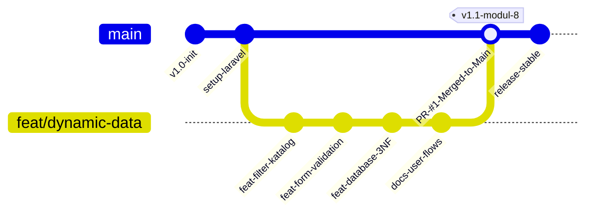
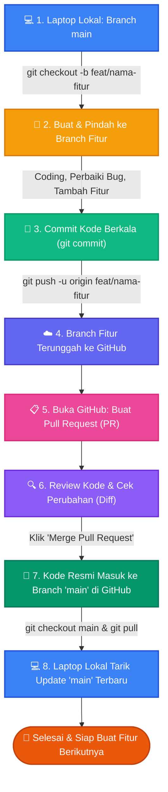

# 🐙 07. Panduan Git Workflow & Manajemen Kontribusi Tim - PlusFood

> **Dokumen Standar Operasional Prosedur (SOP) Git & Kolaborasi Tim**  
> *Panduan Praktis Manajemen Branch, Tata Cara Push, Pull Request (PR), dan Rekam Jejak Kontribusi Tim.*

---

## 📌 1. Filosofi Manajemen Git: Mengapa Menggunakan 2 Jenis Branch?

Dalam pengembangan perangkat lunak modern dan standar industri (*GitHub Flow*), repositori kode **tidak boleh** dikerjakan langsung di branch utama. Sistem PlusFood membagi manajemen kode ke dalam **2 kategori branch**:



### A. Branch Utama (`main`)
* **Karakteristik:** *Production-Ready*, *Stable*, dan Teruji Bebas Bug.
* **Fungsi:** Menyimpan kode resmi yang siap didemokan ke dosen, mentor, juri kompetisi, maupun di-deploy ke server live.
* **Aturan Emas (*Golden Rule*):** **Dilarang keras melakukan commit atau push langsung ke `main`** tanpa melalui pengujian di branch fitur!

### B. Branch Fitur Khusus (`feat/...`)
* **Karakteristik:** *Isolated*, *Safe Playground*, dan Terfokus pada 1 Topik Tugas.
* **Contoh Riil di PlusFood:** `feat/dynamic-data` (khusus pengerjaan data dinamis Modul 8, validasi form, migrasi database, dan alur sistem).
* **Fungsi:** Tempat anggota tim bereksperimen, menulis fitur, memperbaiki kode, dan membuat migrasi database tanpa risiko merusak aplikasi utama yang sedang berjalan stabil.

---

## ❓ 2. Menjawab Pertanyaan: "Apakah saat Push Otomatis Ter-update ke Branch Utama?"

> **Jawabannya: TIDAK OTOMATIS.**

### Penjelasan Cara Kerja Git & GitHub:
1. **Saat kamu menjalankan:**
   ```bash
   git push -u origin feat/dynamic-data
   ```
   Perubahan kode **hanya dikirim ke branch `feat/dynamic-data` di server GitHub**. Branch `main` di GitHub **masih tetap pada kondisi lama** dan belum tersentuh sedikitpun.
2. **Mengapa dirancang demikian?**
   Ini adalah **sistem pengaman (*safety barrier*)**. Bayangkan jika dalam tim ada 3–5 orang yang sedang mengerjakan fitur berbeda, lalu setiap kali mereka push langsung mengubah `main`:
   - Kode yang belum selesai atau masih error akan langsung menimpa kode teman lain.
   - Aplikasi utama akan langsung *crash* atau *conflict*.
3. **Kapan branch utama (`main`) baru ikut ter-update?**
   Branch `main` **HANYA AKAN TER-UPDATE** jika kamu melakukan proses **Merge Pull Request (PR)** di GitHub:
   $$\text{Branch Fitur } (\texttt{feat/dynamic-data}) \xrightarrow[\text{Pull Request}]{\text{Merge}} \text{Branch Utama } (\texttt{main})$$
   Setelah tombol **"Merge pull request"** ditekan di web GitHub, barulah seluruh commit dari branch fitur resmi disatukan (*integrated*) ke dalam branch `main`.

---

## 🔄 3. Diagram Alur Siklus Pengerjaan Fitur (Lifecycle Workflow)

Berikut adalah diagram alur langkah demi langkah dari pengerjaan di laptop lokal hingga menyatu di GitHub:



---

## 🛠️ 4. Panduan Langkah Praktis (SOP Step-by-Step)

### Langkah 1: Memulai Tugas / Fitur Baru
Pastikan branch `main` di komputer lokal kamu sudah paling mutakhir, lalu buat branch baru:
```bash
# 1. Pindah ke branch main
git checkout main

# 2. Ambil update terbaru dari GitHub
git pull origin main

# 3. Buat branch baru untuk fitur yang akan dikerjakan
git checkout -b feat/nama-fitur-kamu
```

### Langkah 2: Menyimpan Progres Kerja (Commit)
Lakukan commit secara teratur dengan pesan yang jelas (*Conventional Commits*):
```bash
# Cek file apa saja yang diubah
git status

# Tandai file yang akan disimpan
git add .

# Simpan dengan pesan commit deskriptif
git commit -m "feat(modul-8): implement dynamic filter and database migrations"
```

### Langkah 3: Mengunggah Branch Fitur ke GitHub (Push)
Kirim branch fitur kamu ke server GitHub:
```bash
git push -u origin feat/nama-fitur-kamu
```
*(Parameter `-u` / `--set-upstream` hanya wajib di ketik saat pertama kali push branch tersebut, selanjutnya cukup `git push`).*

### Langkah 4: Membuat Pull Request (PR) di Web GitHub
1. Buka browser dan kunjungi repositori:  
   [`https://github.com/arya27Q/PlusFood-app`](https://github.com/arya27Q/PlusFood-app)
2. GitHub akan menampilkan banner kuning di atas dengan tombol: **"Compare & pull request"**. Klik tombol tersebut.
3. **Isi Judul PR:** Format ringkas dan jelas, contoh:  
   `feat(modul-8): implement dynamic data, 3NF database architecture, and user flows`
4. **Isi Deskripsi PR:** Cantumkan ringkasan apa saja yang diubah, file dokumentasi yang ditambah, dan hasil pengujian (*verification checklist*).
5. Klik tombol hijau: **"Create pull request"**.

### Langkah 5: Menggabungkan ke Branch Utama (Merge PR)
1. Di halaman Pull Request yang baru dibuat, gulir ke bagian bawah.
2. Pastikan tertulis: *"This branch has no conflicts with the base branch"*.
3. Klik tombol hijau: **"Merge pull request"**.
4. Klik tombol: **"Confirm merge"**.
5. Status PR akan berubah menjadi ungu: **`Merged`**.  
   *(Pada detik inilah branch `main` di GitHub resmi ter-update dengan seluruh pekerjaan kamu).*

### Langkah 6: Menyinkronkan Kembali Komputer Lokal
Setelah berhasil di-merge di GitHub, update branch `main` di komputer kamu agar tidak tertinggal:
```bash
# 1. Pindah kembali ke branch main lokal
git checkout main

# 2. Tarik update hasil merge tadi ke laptop kamu
git pull origin main
```
Sekarang branch `main` di komputermu sudah 100% identik dengan branch `main` di GitHub!

---

## 🏆 5. Manfaat Alur Ini untuk Evaluasi & Rekam Jejak Tim

Mengapa tim penilai, dosen, dan mentor di Vinix Batch 5 sangat menyukai workflow ini?

| Aspek Penilaian | Jika Kerja Langsung di `main` | Jika Pakai Feature Branch & Pull Request |
|---|---|---|
| **Bukti Kontribusi Anggota Tim** | ❌ Sulit dilacak siapa mengerjakan fitur apa karena commit campur aduk. |  **Terekam Presisi**. Di tab *Contributors* dan *Pull Requests* terlihat jelas kontributor masing-masing modul. |
| **Keamanan Kode (*Code Safety*)** | ⚠️ Berbahaya. Jika ada kodingan error, aplikasi langsung rusak untuk semua anggota. |  **100% Aman**. Fitur diuji dulu di branch sendiri sebelum disatukan ke `main`. |
| **Kesiapan Audit & Review** | ⚠️ Reviewer kesulitan membedakan file mana yang baru diubah. |  **Sangat Rapi**. Reviewer cukup membuka tab PR untuk melihat *diff view* hijau/merah secara visual. |
| **Nilai Profesionalisme Rekayasa** | Dinilai masih pemula / *amateur level*. | Dinilai **Enterprise-Grade / Standar Industri Software Engineer**. |

---

Dokumen ini disusun sebagai pedoman baku kolaborasi tim proyek PlusFood © 2026.
