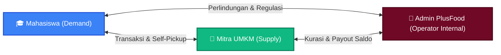
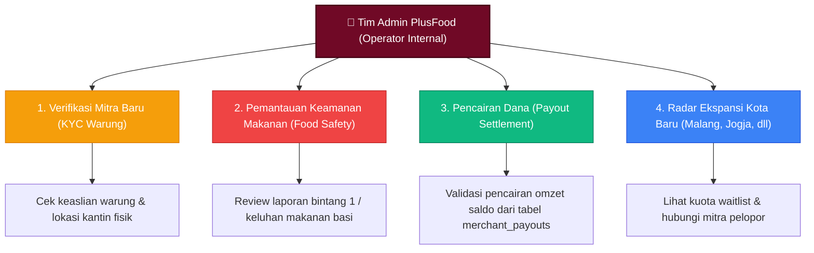

# 🏢 08. Model Operasional Admin, Manajemen Kemitraan UMKM & Ekspansi Pasar - PlusFood

> **Dokumen Panduan Operasional Platform, Strategi Kemitraan Grassroots & Analisis Bisnis 2-Sisi**  
> *Panduan Praktis Peran Administrator, Alur Validasi Pasar Kota Ekspansi (Waitlist), Aspek Legalitas Perjanjian Digital, dan Standar Komunikasi Mitra.*

---

## 📌 1. Filosofi Platform 2-Sisi & Peran Nyata "Admin"

PlusFood mengadopsi model bisnis **Two-Sided Marketplace (Pasar Dua Sisi)** yang menghubungkan dua aktor utama:
1. **Penyedia Makanan Surplus (*Supply Side*)**: Mitra UMKM kuliner dan kantin di sekitar kampus.
2. **Penyelamat Makanan (*Demand Side*)**: Mahasiswa pencari makanan hemat dan bernutrisi.



### Siapa Sebenarnya "Admin" Ini?
* **Admin BUKAN bagian dari mahasiswa dan BUKAN pemilik warung.**
* **Admin adalah Tim Pengelola / Founder / Operator Internal Platform PlusFood** (pengembang sistem dan tim manajemen).
* Posisinya adalah **pihak ketiga yang netral (*trusted intermediary*)** yang memfasilitasi transaksi, menjaga keamanan ekosistem pangan (*food safety*), serta memastikan hak kedua belah pihak terlindungi.

---

## 🔍 2. Empat Pilar Pemantauan Platform (Jika Dashboard Admin Dibangun)

Jika antarmuka Web Admin Backoffice diimplementasikan secara penuh, berikut adalah 4 modul fungsional utamanya:



1. **Verifikasi Mitra Baru (Merchant KYC)**:
   - Memastikan warung yang mendaftar benar-benar beroperasi di radius kampus (bukan akun fiktif).
   - Diatur melalui kolom `is_verified` pada tabel `merchants`.
2. **Pemantauan Kualitas & Keamanan Makanan (*Food Safety Monitoring*)**:
   - Memantau laporan penilaian (*reviews*) atau keluhan kualitas makanan dari mahasiswa.
   - Hak Admin: Menangguhkan (*suspend*) akun atau menonaktifkan menu mitra jika melanggar standar kelayakan konsumsi.
3. **Pencairan Dana Mitra (*Payout Settlement*)**:
   - Menyetujui transfer dana hasil penjualan dari saldo dompet aplikasi (`balance_rp`) ke rekening bank pemilik warung melalui tabel `merchant_payouts`.
4. **Metrik Dampak Lingkungan (*Impact Analytics*)**:
   - Memantau total porsi makanan terselamatkan, total penghematan pengeluaran mahasiswa, dan kilogram emisi karbon CO2 yang berhasil dicegah (tabel `merchant_daily_metrics`).

---

## 🎯 3. Mekanisme Ekspansi Kota Baru (Malang, Jogja, Bandung)

Fitur formulir ekspansi pada katalog PlusFood dirancang sebagai instrumen **Lean Market Validation (Validasi Minat Pasar)** sebelum operasional resmi dibuka di kota baru.

### Mengapa Wajib Melalui Tahap Vote & Waitlist?
1. **Mencegah Kerugian Operasional (*Risk Mitigation*)**:
   Membuka operasional di kota baru membutuhkan kurasi mitra dan promosi. Tanpa data permintaan yang jelas, aplikasi berisiko sepi transaksi.
2. **Keseimbangan Supply & Demand**:
   - Jika hanya ada mahasiswa tapi tidak ada warung $\rightarrow$ Mahasiswa kecewa karena aplikasi kosong.
   - Jika ada warung tapi tidak ada mahasiswa $\rightarrow$ Makanan surplus mitra tetap terbuang dan mitra kehilangan kepercayaan.
3. **Trigger Aktivasi Kota**:
   Ketika akumulasi vote mahasiswa dan pendaftaran mitra di kota tersebut mencapai kuota pilot (misalnya: 15 mitra UMKM & 250 mahasiswa terdaftar), Admin akan memicu aktivasi kota dari status `isComingSoon: true` menjadi `isComingSoon: false`.

---

## 🤝 4. Strategi Kemitraan: UMKM Kantin vs Korporasi Besar

Salah satu kesalahan umum adalah menganggap bermitra kuliner harus melalui proses birokrasi yang panjang dan persetujuan CEO. Dalam konteks PlusFood, kita membedakan mitra ke dalam dua kategori:

| Aspek | Mitra Tipe A: UMKM Kantin & Warung Kampus (Fokus Utama) | Mitra Tipe B: Korporasi / Restoran Waralaba Besar |
|---|---|---|
| **Contoh** | Warung Bu Tin, Kantin Srikandi, Depot Ayam Geprek Suhat, Roti Bakar Sigura-gura | Holland Bakery, BreadTalk, KFC, Pizza Hut |
| **Pengambil Keputusan** | Pemilik Langsung (Ibu/Bapak Pemilik Warung) | Jajaran Direksi, Legal Corporate, Manajer Regional |
| **Birokrasi & CEO** | ❌ **Tidak ada birokrasi.** Keputusan bisa diambil dalam 5 menit. |  **Sangat panjang.** Membutuhkan proposal formal & audit legal. |
| **Motivasi Mitra** | Mendapat uang tunai tambahan dari makanan sisa daripada dibuang rugi. | Menjaga citra brand (*CSR / Corporate Sustainability*). |
| **Pendekatan Lapangan** | **Grassroots / Komunitas**: Datang langsung ke kantin saat jam sepi (15.00-16.30 WIB). | Formal B2B Pitching meeting. |

> 💡 **Kesimpulan Strategi**: Di fase awal, PlusFood berfokus **100% pada UMKM Tipe A**. Hal ini memungkinkan penetrasi pasar yang sangat cepat, biaya akuisisi mitra yang rendah, dan fleksibilitas operasional yang tinggi.

---

## ⚖️ 5. Aspek Hukum & Perjanjian Kemitraan Digital

Apakah kerja sama dengan UMKM memerlukan kontrak bermeterai di hadapan notaris? **Tidak.**

Platform modern menerapkan sistem **Perjanjian Baku Elektronik (*Click-wrap Agreement*)**:
* Pada formulir registrasi mitra (`/mitra/register`), terdapat klausul persetujuan:
  > *"Dengan mendaftar, Anda menyetujui **Syarat & Ketentuan Kemitraan Serta Standar Keamanan Makanan PlusFood**."*
* **Kedudukan Hukum di Indonesia**: Berdasarkan **Undang-Undang ITE (UU No. 11 Tahun 2008 Pasal 18)** dan PP No. 71 Tahun 2019 tentang Penyelenggaraan Sistem dan Transaksi Elektronik, persetujuan elektronik ini sah, mengikat, dan diakui secara hukum perdata.

### 3 Poin Inti Kesepakatan Kemitraan:
1. **Standar Kualitas & Kelayakan Makanan (*Food Safety Guarantee*)**:
   Makanan yang dijual wajib merupakan makanan berlebih yang belum tersentuh konsumen (*untouched excess food*), dimasak pada hari yang sama, dan disimpan higienis.
2. **Ketetapan Diskon Surplus**:
   Mitra berkomitmen memberikan potongan harga minimal 50% dari harga normal untuk mendorong percepatan food rescue oleh mahasiswa.
3. **Mekanisme Self-Pickup & Batas Waktu**:
   Mahasiswa mengambil pesanan langsung ke lokasi toko mitra sebelum batas waktu operasional (*pickup deadline*) berakhir.

---

## 💬 6. Standar Operasional Prosedur (SOP) Onboarding Mitra Baru via WhatsApp

Ketika data calon mitra masuk melalui formulir waitlist kota baru (seperti Malang), tim Admin tidak perlu canggung. Berikut alur komunikasi praktis 5 menit:

### Template Chat WhatsApp Resmi Admin PlusFood:
```text
Halo Selamat Siang Bapak/Ibu [Nama Pemilik],

Perkenalkan, saya [Nama Admin] dari Tim Pengelola Platform PlusFood (Aplikasi Penyelamatan Makanan Surplus Kampus). 

Kami melihat Bapak/Ibu telah mendaftarkan usaha [Nama Warung] di area sekitar kampus [Nama Kampus, misal: Universitas Brawijaya Malang].

Kabar baiknya, saat ini sudah ada lebih dari [Jumlah Vote, misal: 200+] mahasiswa di area kampus tersebut yang siap menyelamatkan makanan surplus dari warung Bapak/Ibu melalui aplikasi kami!

Daripada porsi makanan yang masih lezat di sore/malam hari tersisa dan terbuang rugi, kami siap membantu memasarkan makanan tersebut ke mahasiswa dengan harga hemat.

Berikut kami kirimkan link aktivasi akun toko Bapak/Ibu:
👉 https://plusfood.id/mitra/login

Jika berkenan, tim kami siap memandu pemasangan menu surplus pertama melalui video tutorial singkat (1 menit). Terima kasih atas partisipasi Bapak/Ibu sebagai pelopor food rescue kampus!
```

---

## 🎓 7. Panduan Menjawab Pertanyaan Dosen / Penguji Sidang (Defense Playbook)

Gunakan panduan jawaban ini jika penguji menanyakan aspek proses bisnis dan ketiadaan web admin:

### Pertanyaan 1: "Siapa aktor Admin di sistem ini dan kenapa tidak dibuatkan antarmuka web khusus?"
> **Jawaban:**  
> *"Izin menjawab, Bapak/Ibu. Aktor Admin secara operasional adalah Tim Pengelola Internal Platform PlusFood yang bertindak sebagai pihak ketiga netral untuk kurasi mitra dan pengawasan transaksi.  
> Namun pada **batasan masalah penelitian (MVP 2 POV)**, kami sengaja memfokuskan implementasi antarmuka pada 2 pengguna utama—**Mahasiswa dan Mitra UMKM**—agar pengujian alur penyelamatan makanan dapat dianalisis secara mendalam.  
> Seluruh pemantauan akun, status verifikasi mitra, dan transaksi pada fase ini dikelola secara langsung melalui Database Management System (MySQL via phpMyAdmin). Dashboard analitik khusus Admin kami tempatkan sebagai saran pengembangan lanjutan (**Future Works**)."*

### Pertanyaan 2: "Bagaimana sistem memastikan kota ekspansi seperti Malang siap dibuka?"
> **Jawaban:**  
> *"Kami menerapkan prinsip **Lean Market Validation**. Melalui formulir waitlist di halaman katalog, sistem menghimpun data permintaan riil dari mahasiswa dan penawaran dari warung kuliner setempat. Kota baru hanya akan diaktivasi secara operasional setelah mencapai kuota minimum (pilot threshold), sehingga mencegah terjadinya ketimpangan pasokan dan permintaan saat peluncuran."*

### Pertanyaan 3: "Apakah kerja sama dengan warung makan memiliki dasar hukum yang sah?"
> **Jawaban:**  
> *"Kerja sama kemitraan PlusFood mengacu pada asas **Click-wrap Agreement (Perjanjian Baku Elektronik)** yang diakui secara sah dalam UU ITE Pasal 18. Saat mitra mendaftar, mitra wajib menyetujui Syarat & Ketentuan yang menitikberatkan pada standar kelayakan makanan (*food safety*), komitmen diskon minimal 50%, dan skema pengambilan mandiri (*self-pickup*)."*

---

Dokumen ini disusun sebagai pedoman baku operasional bisnis, tata kelola kemitraan, dan pertanggungjawaban akademis platform PlusFood © 2026.
